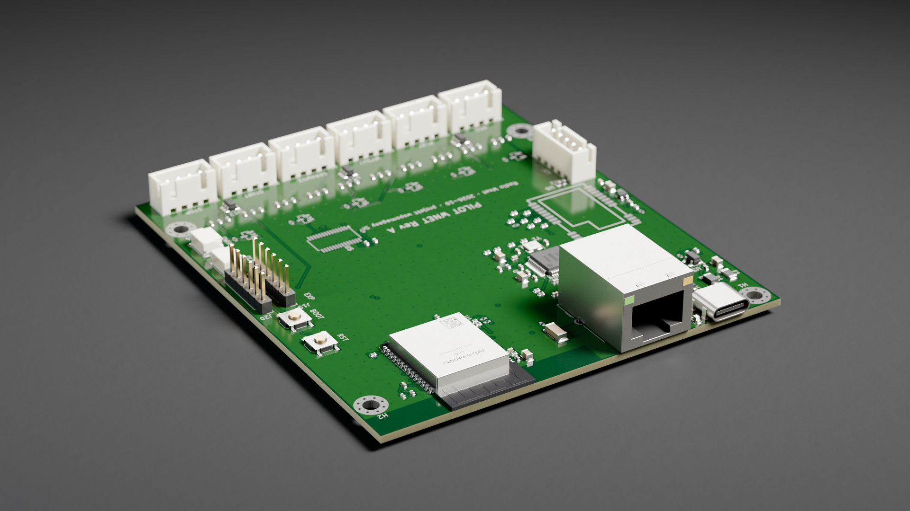

# Pilot Wnet

**An open studio controller for radio: arcade buttons and a joystick on an ESP32-S3 board designed to talk USB HID, Ethernet and Bluetooth LE (firmware not yet run on hardware) and to double as a LoRa 868 MHz mesh node (draft firmware variants).**

Polski: [README.pl.md](README.pl.md)

> [!WARNING]
> **Rev A is a prototype. DO NOT ORDER the Rev A board.**
> The layout has known defects (see [Known issues in Rev A](#known-issues-in-rev-a)) and needs a re-layout (Rev B) before anyone manufactures it.

> [!IMPORTANT]
> **AI-generated design, not reviewed by an engineer.** The Rev A schematic and PCB layout were generated by Python scripts (using SKiDL, Freerouting and a custom router) that AI agents (Claude) wrote and ran. ERC and DRC report 0 errors, but no hardware engineer has reviewed the design. See [How this project was made](#how-this-project-was-made).



*Render, **not a photograph**: the Rev A board has not been manufactured. An AI agent (Claude) made it in Blender (Cycles) from the KiCad files in this repository. The USB-C and RJ45 sockets and the tactile switches are approximate models, part markings are simplified, and parts marked DNP are not shown. More views: [top](docs/img/pilot-wnet-rev-a-render-top.jpg), [ESP32-S3 module close-up](docs/img/pilot-wnet-rev-a-render-esp32.jpg).*

## What is Pilot Wnet

Pilot Wnet is a physical controller for a radio studio. It was developed at the Polish radio station Radio Wnet (Radio Wnet Sp. z o.o.) and is published as open hardware. The operator presses big arcade buttons or moves a joystick; the controller sends authenticated state frames to the studio computer, where host software turns them into actions.

- **Controls:** six arcade buttons (four colour buttons, START and STOP) and a four-way arcade joystick in a wooden bartop-style cabinet; a Qwiic connector for an I2C OLED display.
- **Links to the studio computer (as designed):** USB HID, Ethernet (UDP) and Bluetooth LE. Wi-Fi is available but off by default. Every frame carries a CRC-16 and a truncated HMAC-SHA256 bound to a per-session nonce from the host. The frame and session protocol is documented in [docs/ESP32_PROTOKOL.md](docs/ESP32_PROTOKOL.md) (Polish).
- **Mesh node:** the same board carries an Ebyte E22-900M22S LoRa module (868 MHz) and can be flashed as a node for Meshtastic®- or MeshCore-based mesh networks (draft firmware variants, not built yet).

**There is no public host application.** Over USB the controller is a vendor-defined HID device (usage page `0xFF00`) that sends HMAC-authenticated frames, so you need your own host software to use it; the protocol document above is the reference. The host implementation (an application for the studio computer) is not public (yet); it currently reads USB HID and UDP, and BLE exists only in the firmware.

### Hardware at a glance (Rev A)

| Block | Rev A |
|---|---|
| Board | 90 × 100 mm, 4 layers (F.Cu signals, In1 GND, In2 +3V3, B.Cu signals), FR-4 1.6 mm, all parts on the top side, KiCad 10 |
| MCU | ESP32-S3-WROOM-1-N16R8 (16 MB flash, 8 MB octal PSRAM). The module is flush with the top edge; its PCB antenna lies over the board with a copper keep-out on all four layers (Espressif recommends the antenna beyond the edge or a cut-out; to be considered in Rev B) |
| Ethernet | WIZnet W5500 with a 25 MHz crystal, RJ45 HR911105A with integrated magnetics (the W5500 has no auto-MDIX) |
| Power | USB-C 5 V only (fuse, TVS, USBLC6), TI TLV62569 buck converter 5 V → 3.3 V; no battery in Rev A |
| LoRa | Ebyte E22-900M22S (SX1262, TCXO), 868 MHz, soldered by hand (not assembled by the factory), antenna through the module's IPEX connector |
| Inputs | 6 × JST XH 4-pin for buttons (J10–J15: signal, GND, LED+ 5 V, LED−), JST XH 5-pin for the joystick (J16); RC filters and SRV05-4 ESD arrays |
| Other | Qwiic for the OLED (J17) and for applications (J18), expansion header (J19), service UART (J20), RESET and BOOT buttons, status LED |
| Not assembled (DNP) | button backlight driver (PCA9685 + 6 × AO3400A), the E22 module, option resistors, USB capacitors, the buck converter feed-forward capacitor |
| Assembly | about 128 placed parts, 43 BOM lines with LCSC part numbers (JLCPCB assembly) |

Design decisions and their reasons: [DECYZJE.md](DECYZJE.md) (Polish, D1–D11). Some of its entries are out of date: the reason given for D7 ("solid ground") and the "Consequences" section (enclosure sized for the board) contradict the current files, see [docs/AUDYT_REV_A.md](docs/AUDYT_REV_A.md).

## Status

| Part | State |
|---|---|
| Schematic | generated from `pcb/obwod.py` by `pcb/schemat.py`; ERC 0 errors, 6 warnings (`lib_symbol_mismatch`: flattened derived symbols, no effect on connectivity) |
| PCB layout Rev A | DRC 0 errors, 0 unconnected items, 0 schematic-parity issues, 21 warnings (`lib_footprint_mismatch`: solder paste removed from DNP pads on purpose); **known layout defects, DO NOT ORDER** |
| Firmware (MicroPython) | written and tested in CPython against mocks; **never run on a real board** |
| Meshtastic / MeshCore variants | draft variant files, not built |
| Enclosure | parametric generators for cutting sheets and a 3D model; **does not match the Rev A board yet** (outline, USB-C/RJ45/SMA cut-outs, rear-wall pocket D8); some part dimensions are working values until real parts are measured |
| Circuit simulations | ngspice tests of the analogue sub-circuits (`sim/`); five expected failures document requirements that Rev A does not meet |
| Radio compliance (RED/CE) | **not assessed** |

ERC/DRC figures come from KiCad 10.0.8 on 20 November 2026 (`pcb/wyniki/erc.json`, `pcb/wyniki/drc.json`).

## Known issues in Rev A

An AI-agent audit (Claude agents, 20 Nov 2026, measurements taken from the board file; not reviewed by an engineer) found the defects below. They are the reason for Rev B: see the [Re-layout Rev B](.github/ISSUE_TEMPLATE/relayout-rev-b.md) task. The finding IDs refer to the audit summary in [docs/AUDYT_REV_A.md](docs/AUDYT_REV_A.md) (Polish, with an English summary).

1. **Inner planes carry signals** (layout-01, zasilanie-15). Most signals run on the inner layers (In1 GND, In2 +3V3), while B.Cu is almost empty. Under the W5500 the In1 ground covers only 39% of the package outline.
2. **Buck converter (U3, TLV62569) placed against the TI datasheet** (zasilanie-01, layout-02). The input capacitor is far from the IC, the SW node is long, and the FB trace runs under the SW node.
3. **25 MHz crystal (Y1): bad XO routing** (layout-04). The XO trace from the W5500 to Y1 makes a 17.6 mm detour through 4 vias (via R58 and C41) and runs on In2 directly under the crystal; LoRa SPI traces run on In1 under it. XI (5.1 mm) is fine.
4. **ESD protection far from the connectors** (zasilanie-02, interfejsy-04). For 6 of the 10 inputs the SRV05-4 channel is 46–66 mm (straight line) from its connector, because channels follow list order, not placement; the input traces are up to 93 mm long, mostly on In1.
5. **Ethernet pairs** (layout-05, interfejsy-05). The traces from the W5500 to the RJ45 are not routed as differential pairs over continuous ground: the halves of a pair run on different layers, with length mismatches of 11 mm and 4.6 mm.

Other open points (more in [docs/AUDYT_REV_A.md](docs/AUDYT_REV_A.md)):

- The crystal load capacitors (2 × 18 pF) are probably too small for a crystal with CL = 18 pF, so the oscillator may run fast (interfejsy-09). Simulation results and options: [sim/README.md](sim/README.md) (Polish).
- The W5500 reset RC has a small margin when 3V3 rises slowly (same file); the W5500 is reset only by this RC, not by the ESP32 (interfejsy-14).
- J19 (expansion) and J20 (service UART) are both 1 × 6 headers with **swapped power pins** (J19: pin 1 = +3V3, pin 2 = GND; J20: pin 1 = GND, pin 2 = +3V3). A UART adapter plugged into the wrong header swaps power and ground (interfejsy-03).
- **J20 does not match a standard 6-pin FTDI cable**: in either orientation the cable's VCC (+5 V) lands on EN or IO0 (interfejsy-02).
- **Pin 3 of every button connector J10–J15 always carries +5 V**, although the LED driver is not fitted; a miswired harness feeds 5 V through the SRV05-4 into the 3V3 rail (produkt-15, interfejsy-06).
- **D1 (SMF5.0A, breakdown 6.4–7.0 V) does not protect U3**, whose input is rated at 6 V maximum (zasilanie-04).
- USB D+/D− are not routed as a pair and the ESD path on D− is a stub (layout-06).
- The input of U7 (74LVC1G04) floats while the E22 module is not fitted (zasilanie-06, interfejsy-07).
- The USB-C footprint (J1) should be double-checked against the connector datasheet.
- The firmware uses MicroPython's built-in USB VID/PID; the project has no VID/PID of its own.

## How this project was made

Pilot Wnet is an experiment in agentic hardware design, and we label it as such.

- The circuit is described in Python with SKiDL 3.0 (`pcb/obwod.py`). A custom generator writes the KiCad schematic from it (`pcb/schemat.py`, net labels instead of wires).
- Placement, ground zones and net classes are scripted with KiCad's Python API (`pcb/plytka.py`). Routing was done with Freerouting 2.5.0, and the last connections were closed by a custom raster router (`pcb/v01/`).
- These scripts, the MicroPython firmware and its tests, the SPICE tests, the enclosure and Blender generators, the research reports (`research/`), the decision register, the ordering notes, the audit summary and this documentation were written by AI agents (Claude, by Anthropic) working under human direction. Decisions marked as defaults wait for approval by the project team.
- The result passes ERC and DRC with 0 errors. **No hardware engineer has reviewed the schematic or the layout yet**, and the audit above shows that 0 DRC errors does not make a good board.

For Rev B we want people to take over: a re-layout by a human designer, review by others, and automatic ERC/DRC checks on every change.

## Repository layout

| Path | Contents |
|---|---|
| `pcb/kicad/` | KiCad 10 project: schematic, board, design rules, netlist, library tables |
| `pcb/lib/` | project library (symbols and footprints; the E22 3D model is not included) |
| `pcb/*.py`, `pcb/v01/` | generator and check scripts: SKiDL circuit, schematic generator, placement, routing, fabrication export (notes in Polish: `pcb/README.md`, `pcb/v01/README_v01.md`) |
| `pcb/wyniki/` | ERC and DRC reports (JSON) |
| `firmware/micropython/` | controller firmware in MicroPython and its CPython tests (`testy/`) |
| `firmware/meshtastic/`, `firmware/meshcore/` | draft mesh-node variants (not built); `firmware/ci/build-mesh.yml` is an inactive draft workflow |
| `sim/` | ngspice tests of analogue sub-circuits, generated from `pcb/obwod.py` |
| `projekt/` | `arcade.toml` (enclosure and part dimensions; still assumes an older 100 × 100 mm board, see [Status](#status)) and the cutting-sheet generator (SVG for laser/CNC) |
| `blender/` | generator of the 3D model and renders of the cabinet (Blender batch mode; outputs and the top-panel artwork are not included) |
| `zamowienie/` | ordering notes for Rev A (reference only: do not order Rev A) |
| `research/` | research reports R1, R2, R3 and R5 (Polish, AI-written, sources with check dates; R4 is not included) |
| `docs/` | frame and session protocol (`ESP32_PROTOKOL.md`), hardware overview (`SPRZET.md`), audit summary (`AUDYT_REV_A.md`), all in Polish; renders of the Rev A board (`img/`) |
| `DECYZJE.md` | decision register D1–D11 (Polish) |
| `LICENSES/`, `REUSE.toml`, `NOTICE.md` | licence texts, per-file licensing (REUSE) and third-party notices |
| `.github/` | CI workflows, pull request and issue templates |

## Reproduce and verify

### ERC and DRC (KiCad 10)

The board and project files are saved with KiCad 10.0.8; the schematic is written by `pcb/schemat.py` in an older file format, which KiCad 10 opens and converts on save (expect a large one-time diff). From `pcb/kicad/`:

```sh
kicad-cli sch erc --severity-all --format json -o ../wyniki/erc.json pilot_wnet.kicad_sch
kicad-cli pcb drc --schematic-parity --refill-zones --severity-all --format json -o ../wyniki/drc.json pilot_wnet.kicad_pcb
```

Expected: 0 errors in both reports, 0 unconnected items, 0 schematic-parity issues, and the warnings listed under [Status](#status). CI runs the same checks in the official `kicad/kicad:10.0.8` Docker image on every push to main and every pull request ([.github/workflows/kicad.yml](.github/workflows/kicad.yml)) and keeps the reports as build artefacts. The gate is **0 errors, 0 unconnected items and 0 schematic-parity issues**; other warnings are checked in review.

Do not run "Update footprints from library" on the DNP parts: it restores the solder paste that was removed on purpose.

### Firmware tests (no hardware needed)

CPython 3.11 or newer, standard library only; MicroPython modules are replaced by mocks (`testy/atrapy.py`). Run each test file on its own, from `firmware/micropython/`:

```sh
for t in testy/test_*.py; do python -I -B -X utf8 "$t" || echo "FAILED: $t"; done
```

Windows (cmd): `for %f in (testy\test_*.py) do python -I -B -X utf8 %f`

The mocks show only that the code calls the APIs with the right pins and arguments. They do not show that USB HID, the W5500 or the SX1262 behave that way on a real board. A few tests are skipped on purpose: they document open findings. CI: [.github/workflows/firmware.yml](.github/workflows/firmware.yml).

### Circuit simulations (optional)

From `sim/`: `python -I -B -X utf8 -m unittest discover -s . -p "test_*.py"`. Without ngspice only the calculation and topology tests run. The SPICE tests need the ngspice console binary (set `PILOT_NGSPICE` to its path) and the `spicelib` package from PyPI, which brings NumPy and SciPy.

### Regenerating the board from scripts

The generator chain is published for transparency, but it is not a turnkey build yet. It needs KiCad 10's Python, SKiDL 3.0 and Freerouting 2.5.0 on a Java runtime, and parts of it still assume the original authors' setup. Re-running `pcb/plytka.py` overwrites manual copper edits.

### Dependencies

| Task | Needs |
|---|---|
| Firmware tests | CPython ≥ 3.11, standard library only |
| Firmware on the board | MicroPython for ESP32-S3 and the micropython-lib packages `usb-device-hid`, `aioble`, `lora-sync`, `lora-sx126x` (installed with `mpremote mip install`, see `firmware/README.md`) |
| ERC/DRC | KiCad 10 (`kicad-cli`) |
| Board generator (`pcb/`) | KiCad 10 Python (`pcbnew`), SKiDL 3.0, Freerouting 2.5.0 with a Java runtime, KiKit 1.8.1 (`pcb/fab.py`), NumPy (`pcb/v01/` router), PyMuPDF (`pcb/v01/opis_pdf.py`) |
| Simulations (`sim/`) | ngspice (console binary), `spicelib` (with NumPy, SciPy) |
| Enclosure (`projekt/`, `blender/`) | Python ≥ 3.11 (`tomllib`); Blender in batch mode for `blender/` |
| Licence check | `reuse` (REUSE tool) |

## Licences

| Scope | Licence |
|---|---|
| Hardware design: KiCad project and project library (`pcb/`), including the scripts that generate the design and their CSV/JSON data; enclosure and part geometry and the cutting-sheet generator (`projekt/`) | [CERN-OHL-S-2.0](LICENSES/CERN-OHL-S-2.0.txt) |
| Software: MicroPython firmware and tests (`firmware/micropython/`), MeshCore helper files (`firmware/meshcore/`), the draft mesh CI (`firmware/ci/`), simulations (`sim/`), the Blender generator (`blender/`), CI workflows | [MIT](LICENSES/MIT.txt) |
| Documentation: README files, `docs/`, `research/`, `DECYZJE.md`, `zamowienie/`, CONTRIBUTING, NOTICE, GitHub templates | [CC-BY-SA-4.0](LICENSES/CC-BY-SA-4.0.txt) |
| `.gitignore` files | [CC0-1.0](LICENSES/CC0-1.0.txt) |

Exceptions:

- `firmware/meshtastic/` is a derivative of the Meshtastic firmware and is licensed under the GPL ([GPL-3.0-only](LICENSES/GPL-3.0-only.txt)), like upstream.
- `pcb/lib/pilot_jlc.pretty/ESP32-S3-WROOM-1_Pilot.kicad_mod` and `USB_C_Receptacle_HRO_TYPE-C-31-M-12_Pilot.kicad_mod` are modified footprints from the KiCad libraries: CC-BY-SA-4.0 with the [KiCad libraries exception](LICENSES/KiCad-libraries-exception.txt).
- The E22-900M22S symbol and footprint (`pcb/lib/pilot_jlc.kicad_sym`, `WIRELM-SMD_E22-900M22S.kicad_mod`) were converted from the EasyEDA/LCSC library with easyeda2kicad. Their redistribution terms are not established ([LicenseRef-EasyEDA-Library](LICENSES/LicenseRef-EasyEDA-Library.txt)); they are included only so that the project can be opened and will be redrawn from the Ebyte datasheet in Rev B. The board, schematic and netlist contain embedded copies of them. The E22 3D model is not included.
- `DCO.txt` may be copied only verbatim ([LicenseRef-DCO](LICENSES/LicenseRef-DCO.txt)).

The licence of every file is declared in the [REUSE](https://reuse.software/) format (`LICENSES/`, `REUSE.toml`); `reuse lint` checks it, also in CI ([.github/workflows/reuse.yml](.github/workflows/reuse.yml)). Third-party notices: [NOTICE.md](NOTICE.md). CERN-OHL-S is strongly reciprocal: if you convey (sell or give away) hardware made from a modified design, or the modified design itself, you must make the complete source available to the recipients under the same licence.

Source Location (CERN-OHL-S, section 4): <https://github.com/radiownet/pilot-wnet>. Rev A does not carry it on the silkscreen yet; Rev B will.

## Radio and safety notice

- Pilot Wnet is radio equipment: the ESP32-S3 has Wi-Fi and Bluetooth LE, and the E22 module transmits LoRa at 868 MHz. **Conformity with the Radio Equipment Directive (RED) and CE marking have not been assessed.** The ESP32-S3 module has the manufacturer's radio assessment; that does not make the finished device compliant.
- You build and operate it at your own risk. Whoever places built units on the market is responsible for their conformity.
- Keep to the 868 MHz short-range device rules where you operate: sub-band, maximum e.r.p. and duty cycle (in the EU: ERC Recommendation 70-03 and Decision (EU) 2025/105). The MicroPython LoRa driver is written to refuse settings outside the permitted sub-bands, power above the e.r.p. limit and transmissions beyond the duty cycle (tested only against mocks; the duty-cycle counter starts from zero after every power-up unless the application restores it). Set the antenna gain and losses correctly in the configuration. The Meshtastic and MeshCore variants do not use this driver; they have their own region and duty-cycle settings: check them before transmitting.
- Raw LoRa from the MicroPython firmware does not talk to Meshtastic or MeshCore networks.
- Do not transmit without an antenna connected to the LoRa module.
- Power the board only from USB-C (5 V). For the first power-up use a current-limited supply or a USB power meter.
- **Wire only pins 1–2 of J10–J15** while the LED driver is not fitted: pin 3 always carries +5 V.
- **Do not plug a standard 6-pin FTDI cable into J20**, and mind the swapped power pins on J19 and J20 (see [Known issues in Rev A](#known-issues-in-rev-a)). Use only 3.3 V UART adapters and do not connect their VCC.
- D1 does not protect the buck converter U3 (input rated at 6 V maximum) against overvoltage on VBUS in the 6–7 V range or long surges above 9 V (zasilanie-04).

## Contributing

- **Questions, ideas, your build:** GitHub Discussions (Announcements, Q&A, Show your board, Ideas).
- **Bugs and design review findings:** Issues.
- **Main open task: Re-layout Rev B.** The [task template](.github/ISSUE_TEMPLATE/relayout-rev-b.md) lists the acceptance criteria K1–K12. This work may be paid: ask in Discussions.
- Every commit needs a DCO sign-off (`git commit -s`). AI-assisted contributions are welcome when they are disclosed and reviewed by a person. Details: [CONTRIBUTING.md](CONTRIBUTING.md).

## Language

Most of the documentation (decisions, research, design notes, protocol, audit summary) is in Polish; this README, CONTRIBUTING, NOTICE and the GitHub templates are in English. Translations are welcome, as pull requests or in Discussions. Issues and pull requests can be written in English or Polish.

## Trademarks

- "Radio Wnet" and "Pilot Wnet" identify Radio Wnet Sp. z o.o.; the Radio Wnet logos are not covered by the licences in this repository and are not included.
- Meshtastic® is a registered trademark of Meshtastic LLC. Meshtastic software components are released under various licenses, see GitHub for details. No warranty is provided - use at your own risk. This project is not affiliated with or endorsed by the Meshtastic project; the name is used only to describe compatibility and is not part of the product name.
- The same applies to MeshCore and to other product and company names mentioned here: they belong to their owners.

## Contact and security

This repository lists no personal contact details: please use GitHub Discussions or Issues. Report security problems (for example in frame authentication) privately with the "Report a vulnerability" button in the Security tab, not in a public issue.

---

*This README was drafted by an AI agent (Claude) working under human direction.*
