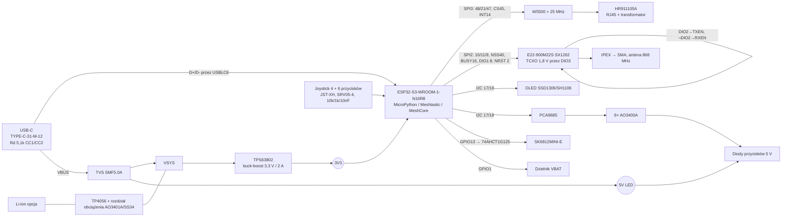

# R3 — Architektura elektroniki „Pilot Wnet” (wersja arcade, własna płytka ESP)

> **Tor:** elektronika · **Data sprawdzenia źródeł:** 18.10.2026 · **Status:** research przed projektem schematu, nie projekt wykonawczy.
> **Opracowanie:** agent SI (Claude) na zlecenie toru elektroniki. Każda decyzja wymaga przeglądu człowieka (HITL) przed zamówieniem płytek.
> **Zasada liczb:** każda liczba ma przypis z adresem URL (strona producenta, karta katalogowa, oficjalna dokumentacja, biblioteka części JLCPCB/LCSC). Fora i sklepy detaliczne są oznaczone jako „sygnał” i nie są źródłem liczb. Wartości projektowe (np. dobór rezystora podciągającego) i obliczenia są opisane wprost jako „wartość projektowa” albo „obliczenie”. Brak potwierdzenia = **[DO WERYFIKACJI]**.

---

## 0. Streszczenie i rekomendacja

1. **Mikrokontroler:** moduł **ESP32-S3-WROOM-1-N16R8** (16 MB flash Quad SPI, 8 MB PSRAM Octal SPI, Wi-Fi 802.11b/g/n, Bluetooth LE 5, natywny USB 2.0 Full-Speed OTG oraz USB Serial/JTAG)[^esp-wroom]. Tylko ta rodzina łączy jednocześnie: natywny USB do HID/CDC, duże PSRAM dla MicroPythona, oficjalny port MicroPythona z wariantem `SPIRAM_OCT`[^mpy-dl] i dojrzałe wsparcie w Meshtastic oraz MeshCore. Klasyczny ESP32 nie ma natywnego USB, ESP32-C6 nie ma PSRAM ani USB OTG, ESP32-H2 nie ma Wi-Fi, a ESP32-P4 nie ma radia i nie ma wariantów urządzeń w Meshtastic (rozdz. 2).
2. **Ethernet:** **WIZnet W5500 przez SPI** + gniazdo **HanRun HR911105A** z transformatorem. MicroPython obsługuje W5500 w `network.LAN` na wszystkich układach ESP32 (poza wariantem `d2wd`)[^mpy-qr], a Meshtastic ma gotowy wariant z W5500 na ESP32-S3 (`t-eth-elite`)[^mt-teth]. RMII (LAN8720/IP101) jest możliwe tylko na klasycznym ESP32 (i P4), więc odpada razem z tymi układami.
3. **Kluczowa decyzja projektowa:** rozkład pinów LoRa, Ethernetu, I2C, przycisku i diody **jak w LilyGO T-ETH-Elite** (ESP32-S3-WROOM-1, 16 MB flash, 8 MB PSRAM OPI, W5500, PoE)[^lilygo]. Dla tej płytki istnieją już wariant Meshtastic `t-eth-elite` (z Ethernetem W5500)[^mt-teth] i środowiska MeshCore `LilyGo_TETH_Elite_sx1262_*`[^mc-teth]. Dzięki temu oba firmware'y mesh da się zbudować z oryginalnych źródeł bez łatania sterowników, a własny wariant różni się od istniejącego tylko kilkoma liniami.
4. **LoRa 868 MHz:** **Ebyte E22-900M22S** (SX1262, TCXO 32 MHz zasilany z DIO3, 22 piny, 20 × 14 mm)[^e22-ds] — zgodny z ustawieniem `SX126X_DIO3_TCXO_VOLTAGE 1.8` w wariancie `t-eth-elite`[^mt-teth]. Wada: w bibliotece JLCPCB tylko 5 szt., jako zamówienie przedpłacone (pre-order)[^jlc-e22det]. Alternatywy: E22-900MM22S (10 × 10 mm, 460 szt. w JLCPCB, pinout i TCXO **[DO WERYFIKACJI]**)[^jlc-e22] oraz Ai-Thinker Ra-01SH (1671 szt. w JLCPCB i 1 671 szt. w LCSC, ale karta nie mówi, czy ma TCXO)[^jlc-ra][^lcsc-ra][^ra-spec].
5. **Architektura firmware:** Meshtastic i MeshCore to osobne programy w C++, a nie biblioteki MicroPythona, więc na jednym ESP32-S3 działa w danej chwili **albo** MicroPython (pilot), **albo** węzeł mesh. Rekomenduję:
   - **Rev A (pierwsza seria):** jeden ESP32-S3, zmiana roli przez wgranie innego firmware przez USB. Najtańsze i najszybsze do sprawdzenia: cały tor radiowy i ethernetowy da się przetestować na gotowej płytce LilyGO T-ETH-Elite z nakładką LoRa przed zamówieniem PCB.
   - **Rev B (gdy węzeł mesh ma działać stale, równolegle z pilotem):** ESP32-S3 (MicroPython, HID, Ethernet) + osobny moduł **RAK4630** (nRF52840 + SX1262 z TCXO, 22 dBm, 15 × 23 mm, CE)[^rak4630] z firmware Meshtastic lub MeshCore, połączone UART-em i/lub koncentratorem USB **CH334F**[^jlc-ch334]. RAK4630 kosztuje w JLCPCB 17,0060 USD (424 szt.)[^jlc-rak].
6. **Zasilanie:** USB-C (Rd 5,1 kΩ na CC1 i CC2 osobno, USBLC6-2SC6, TVS SMF5.0A), przetwornica **TPS63802** (buck-boost, wejście 1,3–5,5 V, 2 A dla VI ≥ 2,3 V i VO = 3,3 V)[^ti-63802], bo ta sama przetwornica obsłuży zasilanie z USB i z ogniwa Li-ion. Potwierdzony szczytowy pobór szyny 3,3 V (Wi-Fi TX + W5500 TX + LoRa TX) to około 0,61–0,63 A (obliczenie w rozdz. 8.5), więc zapas względem 2 A jest ponad trzykrotny.
7. **Najważniejsze ryzyka:** stan magazynowy E22-900M22S w JLCPCB, piny strapping GPIO45/GPIO46 użyte w T-ETH-Elite (rozdz. 6.4), brak auto-MDIX w W5500 (rozdz. 4.4), pobór z USB > 500 mA przy wszystkich obciążeniach naraz (rozdz. 8.5) oraz obowiązki zgodności RED dla gotowego urządzenia radiowego (rozdz. 5.6).

---

## 1. Założenia i kontekst

- **Host:** komputer studyjny (laptop z Windows 11) nie ma gniazda RJ45; Ethernet idzie przez stację dokującą. Pilot łączy się z komputerem studyjnym trzema drogami: USB-C (HID + CDC), Ethernet (przez stację dokującą lub przełącznik w tej samej sieci LAN) oraz Wi-Fi/Bluetooth LE.
- **Wejścia:** joystick 8-kierunkowy na 4 mikroprzełącznikach + 6 przycisków (RECORD czerwony, PLAY żółty, WYŚLIJ niebieski, SPRAWDŹ zielony, START mały, STOP duży) = 10 wejść. Tor mechaniki (R2) ustalił, że joysticki Sanwa JLF/JLX2 i Seimitsu LS-32 mają złącze 5-pinowe (masa + 4 kierunki), a raster złącza na płytce joysticka trzeba zmierzyć na próbce[^r2].
- **Podświetlenie przycisków:** tor R2 podaje, że wszystkie potwierdzone diody w przyciskach arcade pracują na 5 V (Seimitsu PSL-30N, Ultimarc Ultralux; przycisk Adafruit 5 V przy 10 mA — dane sklepu)[^r2]. Projektuję szynę LED 5 V z opcjonalną przetwornicą 12 V (rozdz. 9.3).
- **Wyświetlacz:** mały OLED I2C (SSD1306 lub SH1106) na przewodzie.
- **Montaż:** JLCPCB z częściami z biblioteki JLCPCB/LCSC. Numery „C…” są wspólne dla LCSC i JLCPCB (ta sama część E22-900M22S ma numer C411293 w obu serwisach)[^jlc-e22det][^lcsc-e22-miss]. Stany magazynowe w obu serwisach są **różne** (osobne magazyny), a do montażu w JLCPCB liczy się stan biblioteki JLCPCB. Tor R1 ustalił, że moduł ESP32-S3-WROOM-1-N16R8 w JLCPCB to montaż „Standard Only” z kontrolą RTG[^r1].

---

## 2. Mikrokontroler — porównanie

### 2.1. Tabela porównawcza

| Cecha | **ESP32-S3** (WROOM-1-N16R8) | **ESP32** klasyczny + PHY RMII | **ESP32-P4** + koprocesor radiowy | **ESP32-C6** | **ESP32-H2** |
|---|---|---|---|---|---|
| Rdzeń | 2 × Xtensa LX7 do 240 MHz[^esp-wroom] | [DO WERYFIKACJI — strona produktu nie podaje][^esp32-page] | 2 × RISC-V do 400 MHz + LP-Core do 40 MHz[^p4-page] | RISC-V HP do 160 MHz + LP RISC-V do 20 MHz[^c6-page] | 1 × RISC-V niskiej mocy[^h2-page] |
| Bluetooth | Bluetooth LE 5, Bluetooth mesh[^esp-wroom] | Bluetooth v4.2 BR/EDR + Bluetooth LE[^esp32-ds] | brak w P4; przez koprocesor ESP32-C/S (ESP-Hosted lub ESP-AT po SPI/SDIO/UART)[^p4-page] | Bluetooth LE 5.3 (certyfikowany)[^c6-ds] | Bluetooth 5 (LE)[^h2-page] |
| Wi-Fi | 802.11b/g/n 2,4 GHz, do 150 Mb/s[^esp-wroom] | tak, 2,4 GHz[^esp32-ds] | tylko przez koprocesor[^p4-page] | Wi-Fi 6 (802.11ax) 2,4 GHz[^c6-ds] | strona produktu nie wymienia Wi-Fi[^h2-page] |
| 802.15.4 (Thread/Zigbee) | nie | nie | nie | tak[^c6-ds] | tak[^h2-page] |
| Ethernet | tylko zewnętrzny układ SPI (W5500, DM9051, KSZ8851SNL)[^mpy-qr] | wbudowany MAC z DMA i IEEE 1588 + zewnętrzny PHY RMII[^esp32-ds][^mpy-qr] | wbudowany EMAC[^p4-ds] | tylko SPI[^mpy-qr] | tylko SPI[^mpy-qr] |
| Natywny USB | USB 2.0 Full-Speed OTG + USB Serial/JTAG[^esp-wroom] | brak kontrolera USB w karcie (potrzebny mostek USB-UART, więc bez HID po USB)[^esp32-ds] | USB 2.0 High-Speed OTG + Full-Speed OTG[^p4-ds] | tylko USB Serial/JTAG (bez OTG)[^c6-ds] | [DO WERYFIKACJI] |
| PSRAM | 8 MB Octal SPI w N16R8[^esp-wroom] | do 2 MB w obudowie (warianty R2) lub zewnętrzne[^esp32-ds] | 16 lub 32 MB w obudowie (1,8 V)[^p4-ds] | karta wymienia tylko zewnętrzny flash, PSRAM nie występuje[^c6-ds] | strona podaje 320 KB SRAM i 2/4 MB flash w obudowie, bez PSRAM[^h2-page] |
| GPIO | 36 na module, w tym 4 strapping; przy PSRAM Octal IO35–IO37 niedostępne → 33[^esp-wroom] | 34, w tym 5 strapping i 6 tylko-wejściowych[^esp32-ds] | 55, w tym 5 strapping[^p4-ds] | 30 (QFN40) lub 22 (QFN32), 5 strapping[^c6-ds] | 19[^h2-page] |
| MicroPython (port esp32) | `ESP32_GENERIC_S3`, wariant `SPIRAM_OCT`, v1.29.0 z 24.08.2026[^mpy-dl] | `ESP32_GENERIC`[^mpy-ports] | `ESP32_GENERIC_P4`[^mpy-ports] | `ESP32_GENERIC_C6`[^mpy-ports] | `ESP32_GENERIC_H2`[^mpy-ports] |
| Meshtastic | 68 katalogów wariantów w `variants/esp32s3`, w tym `t-eth-elite` z W5500[^mt-vars-s3][^mt-teth] | 30 wariantów w `variants/esp32`; żaden z nazwy nie wskazuje Ethernetu[^mt-vars-esp32] | katalog `variants/esp32p4` zawiera tylko plik `esp32p4.ini`; P4 nie ma na liście urządzeń[^mt-vars-p4][^mt-dev] | obsługiwany (LILYGO T-LoRa C6, M5Stack Unit C6L), ale według dokumentacji firmware nie obsługuje na nim Bluetootha[^mt-dev] | brak katalogu `esp32h2`[^mt-vars] |
| MeshCore | m.in. `heltec_v3`, `lilygo_teth_elite`, `lilygo_t3s3`, `xiao_s3`[^mc-vars] | m.in. `heltec_v2`, `lilygo_tlora_v2_1`[^mc-vars] | brak wariantu[^mc-vars] | `lilygo_tlora_c6`, `xiao_c6`, `m5stack_unit_c6l`[^mc-vars] | brak wariantu[^mc-vars] |

### 2.2. Wnioski

- **ESP32-S3** jest jedynym układem, który spełnia wszystkie wymagania naraz. Wariant N16R8 daje 8 MB PSRAM dla MicroPythona, ale zajmuje IO35–IO37[^esp-wroom], co wyklucza bezpośrednie użycie definicji pinów płytek bez PSRAM Octal (Heltec V3 używa GPIO35/36/37 na diodę, Vext i ADC_CTRL[^mt-heltec]; LilyGO T3-S3 ma DIO1 i BUSY radia na GPIO33/34[^mt-t3s3]). Dlatego punktem odniesienia jest T-ETH-Elite, który ma ten sam typ pamięci[^lilygo].
- Moduł N16R8 ma dopuszczalną temperaturę otoczenia –40 ~ 65 °C (85 °C po włączeniu ECC PSRAM, kosztem 1/16 pojemności)[^esp-wroom]. W zamkniętej drewnianej skrzynce z przetwornicą i W5500 trzeba to sprawdzić pomiarem **[DO WERYFIKACJI]**.
- Jeśli blat będzie miał płytę stalową (wariant W1 z toru R2[^r2]), antena PCB modułu WROOM-1 nie powinna leżeć pod metalem. Wtedy lepszy jest **ESP32-S3-WROOM-1U-N16R8** ze złączem antenowym (19,2 × 18 mm wg JLCPCB, 19 164 szt., 5,1670 USD)[^jlc-s3u][^esp-wroom].
- **Klasyczny ESP32 + LAN8720** ma wbudowany MAC, ale nie ma natywnego USB (brak HID po kablu), a RMII zajmuje dużą część z 34 GPIO[^esp32-ds]. Odrzucam.
- **ESP32-P4** ma EMAC i szybki USB, lecz bez radia; Wi-Fi i BLE wymagają drugiego układu przez ESP-Hosted[^p4-page], a Meshtastic nie ma dla niego urządzeń[^mt-vars-p4]. Karta P4 ma status „Pre-release v0.7”[^p4-ds]. Odrzucam w Rev A.
- **ESP32-C6** nie ma PSRAM ani USB OTG[^c6-ds], a Meshtastic nie obsługuje na nim Bluetootha[^mt-dev]. **ESP32-H2** nie ma Wi-Fi[^h2-page]. Odrzucam.

---

## 3. Firmware: MicroPython kontra Meshtastic/MeshCore — jedna czy dwie jednostki

### 3.1. Fakty

- Meshtastic budowany jest w PlatformIO; wariant `t-eth-elite` dziedziczy po `esp32s3_base`, używa tablicy partycji `default_16MB.csv`, flagi `-D HAS_UDP_MULTICAST=1` oraz `CONFIG_ETH_ENABLED=y`[^mt-teth-ini].
- MeshCore ma dla T-ETH-Elite środowiska: `repeater`, `room_server`, `companion_radio_usb`, `companion_radio_ble` i `kiss_modem`; w pliku nie ma słowa „Ethernet”, „ETH” poza nazwą płytki ani „W5500”[^mc-teth]. MeshCore na tej płytce **nie używa Ethernetu jako transportu**. Heltec V3 ma w MeshCore dodatkowo `companion_radio_wifi`[^mc-heltec].
- Meshtastic: włączenie Wi-Fi wyłącza Bluetooth, a jednocześnie działa jedna metoda połączenia z aplikacją[^mt-net]. Ethernet włącza się ustawieniem `network.eth_enabled` (domyślnie `false`)[^mt-net]. W kodzie inicjalizacji W5500 na ESP32 jest wywołanie `ETH.begin(ETH_PHY_W5500, 1, ETH_CS_PIN, ETH_INT_PIN, ETH_RST_PIN, SPI3_HOST, …)`[^mt-wifi].
- Wariantu `t-eth-elite` nie ma na oficjalnej liście sprzętu Meshtastic (API `deviceHardware`), są tam np. `heltec-v3` (supportLevel 1), `station-g2` (supportLevel 2) i `tlora-t3s3-v1` (supportLevel 1)[^mt-hw]. Ostatnie wydanie stabilne to v2.7.26.54e0d8d z 24.06.2026, z archiwami zbiorczymi `firmware-esp32s3-…zip`[^mt-rel]. Czy archiwum zawiera obraz `t-eth-elite` i czy jest on w webowym instalatorze — **[DO WERYFIKACJI]**. Bezpieczne założenie: firmware Meshtastic z Ethernetem budujemy sami (`pio run -e t-eth-elite` lub własny wariant).

### 3.2. Wnioski i warianty

| | **Rev A — jedno MCU** | **Rev B — dwa MCU** |
|---|---|---|
| Skład | ESP32-S3-WROOM-1-N16R8 + E22-900M22S + W5500 | Rev A + RAK4630 (nRF52840 + SX1262) + koncentrator USB CH334F; moduł E22 na ESP32-S3 opcjonalny |
| Pilot (MicroPython) | tak | tak, bez przerw |
| Węzeł Meshtastic/MeshCore | po wgraniu innego firmware (pilot wtedy nie działa jako MicroPython) | stale, niezależnie od pilota |
| Ethernet w trybie mesh | Meshtastic tak (W5500), MeshCore nie[^mc-teth] | Ethernet tylko po stronie ESP32-S3 |
| Praca na baterii jako węzeł | możliwa, ale ESP32-S3 + W5500 zużywa dużo (rozdz. 8.6) | nRF52840 jest projektowany do niskiego poboru (pomiar **[DO WERYFIKACJI]**) |
| Koszt dodatkowy (JLCPCB, 1 szt.) | — | RAK4630 17,0060 USD[^jlc-rak] + CH334F 0,6237 USD[^jlc-ch334] + elementy towarzyszące |
| Ryzyko | niskie — pinout sprawdzony na gotowej płytce | wyższe — drugi tor RF, koncentrator USB, druga antena |

**Rekomendacja:** pierwsza seria w wariancie **Rev A**, z pinami zgodnymi z T-ETH-Elite. Przed zamówieniem PCB kupić jedną płytkę LilyGO T-ETH-Elite z nakładką LoRa i przetestować na niej MicroPython (W5500 + SX1262), Meshtastic `t-eth-elite` i MeshCore `LilyGo_TETH_Elite_sx1262`. Decyzję o Rev B podjąć po tych testach, gdy będzie wiadomo, czy redakcja potrzebuje węzła mesh pracującego stale.

Uwaga: przełączanie dwóch różnych firmware'ów na jednym układzie bez ponownego wgrywania (np. dwie partycje OTA z wyborem przyciskiem) wymaga wspólnej tablicy partycji, a Meshtastic i MicroPython używają własnych. Nie zalecam tego w Rev A **[DO WERYFIKACJI, jeśli kiedyś potrzebne]**.

---

## 4. Ethernet

### 4.1. W5500 przez SPI kontra RMII

| Kryterium | W5500 (SPI) | LAN8720/IP101 (RMII) |
|---|---|---|
| Układy ESP32 | wszystkie ESP32 (poza `d2wd`) w MicroPythonie[^mpy-qr] | tylko układy z EMAC: klasyczny ESP32[^mpy-qr], P4[^p4-ds] |
| ESP32-S3 | tak | nie (S3 nie ma EMAC; MicroPython opisuje wbudowany MAC tylko dla oryginalnego ESP32)[^mpy-qr] |
| Piny MCU | SPI (SCK, MOSI, MISO) + CS + INT (+ RST opcjonalnie)[^mpy-qr] | MDC, MDIO, zegar referencyjny i linie RMII[^mpy-qr] |
| Meshtastic | wariant `t-eth-elite` (ESP32-S3)[^mt-teth] | nie znalazłem wariantu ESP32 z Ethernetem w `variants/esp32`[^mt-vars-esp32] |
| Pobór (3,3 V, 25 °C) | 128 mA przy łączu 100M, 132 mA przy nadawaniu 100M, 75 mA przy łączu 10M, 13 mA w power-down[^w5500-ds] | [nie dotyczy] |

### 4.2. Oprogramowanie

- **MicroPython:** `network.LAN(spi=…, phy_type=network.PHY_W5500, phy_addr=0, cs=Pin(…), int=Pin(…))`; wymagane argumenty `spi`, `cs`, `int`, `phy_type`, `phy_addr`, opcjonalne `reset` i `power`; obsługiwane typy SPI: `PHY_KSZ8851SNL`, `PHY_DM9051`, `PHY_W5500`; szybkość SPI ustalana jest przy kompilacji, a ustawienie zegara w obiekcie SPI jest ignorowane[^mpy-qr]. Ogólna strona `network.LAN` opisuje tylko port mimxrt i odsyła do quickref ESP32[^mpy-lan].
- **ESP-IDF (v6.1):** sterowniki modułów SPI-Ethernet są w repozytorium `esp-eth-drivers` i w ESP Component Registry[^idf-eth]; repozytorium wymienia CH390, DM9051, ENC28J60, KSZ8851SNL, LAN865X (10BASE-T1S), W5500 i W6100[^eth-drivers]. Sterownik ESP nie używa sprzętowego stosu TCP/IP W5500 (sygnał z opisu projektu, nie z dokumentacji Espressif)[^w5500-signal].
- **Meshtastic:** `HAS_ETHERNET 1`, `USE_WS5500 1`, piny ETH: MISO 47, MOSI 21, SCLK 48, CS 45, INT 14, RST –1, `ETH_ADDR 1`[^mt-teth]. Kod obsługuje też CH390D (`USE_CH390D`)[^mt-wifi]. Usługi przez Ethernet: serwer API, NTP, syslog, multicast UDP (gdy `HAS_UDP_MULTICAST`)[^mt-eth]. Inne płytki z Ethernetem w Meshtastic to RAK4631 + RAK13800 (W5100S), z kompilacją `rak4631_eth_gw` dla bramki RAK[^rak-gw].
- **MeshCore:** brak transportu Ethernet w środowiskach T-ETH-Elite[^mc-teth].

### 4.3. Gniazdo, magnetyka, zabezpieczenia

- **HR911105A** (HanRun) — RJ45 z transformatorem i diodami, ekranowane, „Filtered”, „Non-PoE”, montaż przewlekany, 0–70 °C: JLCPCB C12074, 68 148 szt., 1,9787 USD (1+), 1,3338 USD (31+)[^jlc-hr]; LCSC 10 970 szt., 1,9972 USD (1+)[^lcsc-hr].
- W5500 wymaga zewnętrznego kwarcu 25 MHz[^w5500-ds]: **X322525MOB4SI** (YXC, 3225, 12 pF, ±10 ppm), JLCPCB C9006, część Basic, 243 617 szt., 0,0949 USD[^jlc-xtal].
- Karta W5500 podaje dla transformatora indukcyjność 350 µH (rys. 24)[^w5500-ds]. Zgodność HR911105A z tym wymaganiem oraz układ terminacji linii TX/RX trzeba przenieść z referencyjnego schematu WIZnet **[DO WERYFIKACJI]**.
- Reset W5500: impuls RSTn ≥ 500 µs, PLL lock ≤ 1 ms[^w5500-ds]. T-ETH-Elite nie steruje RSTn z MCU (`ETH_RST_PIN -1`)[^mt-teth], więc na płytce stosuję obwód RC zapewniający reset przy włączeniu (wartości projektowe do policzenia).
- W5500 pracuje na 3,3 V z wejściami tolerującymi 5 V, obudowa LQFP-48 7 × 7 mm[^w5500-ds].
- Ochrona: izolacja galwaniczna zapewnia transformator gniazda; dodatkowe tłumiki ESD na liniach TX/RX opcjonalnie **[DO WERYFIKACJI wg noty WIZnet]**.

### 4.4. Połączenie z komputerem studyjnym

- **W5500 nie obsługuje auto-MDIX** — karta zaleca kabel prosty do przełącznika lub routera i skrzyżowany do komputera lub drugiego W5500, chyba że druga strona ma auto-MDIX[^w5500-ds]. Przy podłączeniu wprost do gniazda stacji dokującej komputera studyjnego zadziała zwykły kabel, jeśli karta sieciowa stacji ma auto-MDIX **[DO WERYFIKACJI w specyfikacji stacji HP]**.
- Przy połączeniu bezpośrednim (bez serwera DHCP) pilot w MicroPythonie powinien mieć adres statyczny lub link-local — wybór konfiguracji po stronie aplikacji.

### 4.5. PoE (opcja, nie w Rev A)

- Moduł **Silvertel Ag9905M**: 5 V, 9 W, seria Ag9900 zgodna z IEEE 802.3af[^silvertel]. Wymaga gniazda RJ45 z wyprowadzonymi odczepami środkowymi transformatora; HR911105A jest opisany jako „Non-PoE”[^jlc-hr], więc PoE oznacza zmianę gniazda **[DO WERYFIKACJI — dobór gniazda PoE]** oraz zasilacz/przełącznik PoE po stronie sieci. Rekomenduję pominięcie PoE w Rev A.

---

## 5. LoRa 868 MHz

### 5.1. Moduły SX1262 w JLCPCB/LCSC (stan 18.10.2026)

| Moduł | Nr C (LCSC/JLCPCB) | Stan i cena JLCPCB | Stan i cena LCSC | Wymiary | Uwagi |
|---|---|---|---|---|---|
| **Ebyte E22-900M22S** | C411293 | 5 szt., zamówienie przedpłacone, szac. 6,9432 USD/szt. (strona części), ostatnie zamówienie 12 szt. po 5,72 USD; w wynikach wyszukiwania szac. 6,6884 USD i czas dostawy ok. 10 dni[^jlc-e22det][^jlc-e22] | wyszukiwarka LCSC: brak wyników dla C411293[^lcsc-e22-miss] | 20 × 14 mm[^e22-ds] | TCXO 32 MHz zasilany z DIO3; TXEN/RXEN wyprowadzone[^e22-ds] |
| **Ebyte E22-900MM22S** | C5333985 | 460 szt., 6,5203 USD (1+), 4,4127 USD (1000+); opis JLCPCB podaje „915MHz”[^jlc-e22] | brak wyników[^lcsc-e22-miss] | 10 × 10 × 2,5 mm; 850–930 MHz wg Ebyte[^e22mm-page] | pinout, TCXO i przełącznik RF **[DO WERYFIKACJI]** |
| **Ai-Thinker Ra-01SH** | C2764087 | 1 671 szt., 4,5646 USD (1+), 2,6970 USD (800+)[^jlc-ra] | 1 671 szt., 4,5923 USD (1+), 3,9616 USD (10+), 2,7134 USD (800+)[^lcsc-ra] | 17 × 16 × 3,2 mm[^ra-spec] | TXEN/RXEN wyprowadzone; TCXO czy kwarc — karta milczy[^ra-spec]; certyfikat CE-RED na stronie producenta[^ra-doc] |
| Ai-Thinker Ra-01SH-P | C42420049 | 98 szt., 5,3923 USD[^jlc-ra] | — | 17 × 16 mm[^jlc-ra] | wersja większej mocy — zbędna przy limitach UE |
| Semtech SX1262IMLTRT (sam układ) | C191341 | 1 783 szt., 3,2096 USD (1+), 1,6962 USD (3000+)[^jlc-sx1262] | — | QFN-24 4 × 4 mm[^jlc-sx1262] | wymaga własnego toru RF, TCXO i dopasowania — nie w Rev A |
| Vollgo SX1262S8S+T-X1 | C718838 | 94 szt., 7,0052 USD (1+), 4,3883 USD (80+); opis: 868 MHz, –139 dBm[^jlc-sx1262] | — | 16 × 16 mm[^jlc-sx1262] | dokumentacja **[DO WERYFIKACJI]** |
| Silicontra SX1262TR8-GC | C42381682 | 140 szt., 5,6159 USD; opis: 868 MHz, –136 dBm[^jlc-sx1262] | — | 15 × 15 mm[^jlc-sx1262] | dokumentacja **[DO WERYFIKACJI]** |
| Seeed Wio-SX1262 | C55348741 | 0 szt., zamówienie przedpłacone, szac. 14,4209 USD[^jlc-sx1262] | — | 11,6 × 11 mm[^jlc-sx1262] | niedostępny |
| Ebyte E22-900M30S | C411294 | 437 szt., 7,2190 USD; opis: 31 dBm, 650 mA[^jlc-e22] | — | 38,5 × 24 mm[^jlc-e22] | moc ponad potrzeby UE — nie zalecam |

Dwie korekty dla innych torów:
- **Ra-01S(SX1262)** C55652137 (30 szt., 4,1205 USD)[^jlc-sx1262] to inny model niż Ra-01SH; jego zakres częstotliwości trzeba sprawdzić przed użyciem na 868 MHz **[DO WERYFIKACJI]**.
- **Seeed 317990829** C5129913, wskazany w R1 jako „moduł LoRa Seeed”[^r1], ma według opisu JLCPCB interfejsy ADC, I2C, USART i SWD oraz obudowę SMD-28P 12 × 12 mm, a stan 0 szt. (szac. 8,4056 USD)[^jlc-seeed]. To nie jest moduł SX1262 sterowany przez SPI, więc nie pasuje do Meshtastic/MeshCore na ESP32. Opis wskazuje na moduł z własnym mikrokontrolerem (np. rodziny Wio-E5) **[DO WERYFIKACJI]**.

### 5.2. Ebyte E22-900M22S — dane z karty producenta

Karta „E22-900M22S 产品规格书” (PDF dołączony do strony części JLCPCB C411293)[^e22-ds]:

- Zakres pracy 850–930 MHz (typowo 868/915 MHz); moc maks. 21,4 / 21,5 / 22,3 dBm (min./typ./maks.); czułość –144 / –146 / –147 dBm przy 0,3 kb/s; prąd nadawania 119 mA, odbioru 6,8 mA, uśpienia 2 µA; kwarc 32 MHz; SPI 0–10 Mb/s; FIFO 256 B; wymiary 20 × 14 mm; raster 1,27 mm; antena: półotwory lub IPEX, ok. 50 Ω.
- Zasilanie: w tabeli pinów VCC 1,8–3,7 V, a w tabeli parametrów uwagę, że dopiero napięcie od 3,3 V gwarantuje pełną moc wyjściową. JLCPCB podaje 2,5–3,7 V[^jlc-e22det]. Projektuję zasilanie 3,3 V.
- Piny: 1–5 GND, **6 RXEN** (wejście, aktywne wysokim, do MCU), **7 TXEN** (do MCU lub do DIO2), **8 DIO2**, 9 VCC, 10–12 GND, **13 DIO1**, **14 BUSY**, **15 NRST** (aktywne niskim), **16 MISO**, **17 MOSI**, **18 SCK**, **19 NSS**, 20 GND, **21 ANT**, 22 GND.
- Karta podaje, że DIO3 zasila wewnętrznie TCXO 32 MHz; DIO2 można połączyć z TXEN zamiast z MCU.
- Producent zaleca rezystory ochronne 200 Ω na liniach do MCU oraz ostrzega przed sygnałami 5 V.
- Ebyte deklaruje certyfikaty FCC, CE i RoHS[^e22-ds][^e22-page]; dokument RED dla modułu **[DO WERYFIKACJI]**.

### 5.3. Sterowanie przełącznikiem RF (E22)

Komentarze w wariancie Meshtastic `EBYTE_ESP32-S3` opisują cztery sposoby[^mt-ebyte]:
1. DIO2 → TXEN i zanegowane DIO2 → RXEN — bez dodatkowych pinów MCU, ale moduł nie wejdzie w uśpienie niskiej mocy, bo TXEN i RXEN nie mogą być naraz niskie.
2. DIO2 → TXEN, pin MCU → RXEN — oszczędza jedną ścieżkę.
3. Dwa piny MCU → TXEN i RXEN — pozwala rozpędzić wzmacniacz przed nadawaniem.
4. Pin MCU → TXEN, zanegowane DIO2 → RXEN — niezalecane (możliwe chwilowe TXEN i RXEN naraz).

Wariant `t-eth-elite` definiuje tylko `SX126X_DIO2_AS_RF_SWITCH`, bez pinów RXEN/TXEN[^mt-teth]. Dla zgodności z nim wybieram **sposób 1**: DIO2 → TXEN oraz DIO2 → inwerter **74LVC1G04GW** (JLCPCB C10237, 14 621 szt., 0,0680 USD, zasilanie 1,65–5,5 V)[^jlc-lvc04] → RXEN. Dodatkowo pole zworki pozwala odłączyć inwerter i podać RXEN z GPIO we własnym wariancie, gdy węzeł ma oszczędzać energię na baterii.

### 5.4. Ra-01SH — dlaczego tylko jako zapas

- Karta: SX1262, 803–930 MHz, 22 dBm, maks. 140 mA, odbiór 4,2 mA, czuwanie 1,6 mA, czułość do –140 dBm, zasilanie 2,7–3,6 V z zaleceniem zasilacza o prądzie powyżej 200 mA i LDO lub przetwornicy z tętnieniem ≤ 30 mV, SPI do 10 MHz, 16 pinów (ANT, GND, 3,3 V, RESET, **TXEN**, DIO1, DIO2, DIO3, GND, BUSY, **RXEN**, SCK, MISO, MOSI, NSS, GND)[^ra-spec].
- Karta (V1.1 z 18.08.2020) w tabeli parametrów elektrycznych podaje częstotliwość pracy 410–525 MHz, co przeczy zakresowi 803–930 MHz na str. 5 i 6 — to błąd redakcyjny karty, ale trzeba to potwierdzić u producenta **[DO WERYFIKACJI]**[^ra-spec].
- Karta nie mówi, czy moduł ma TCXO, czy kwarc[^ra-spec]. Wariant `t-eth-elite` ustawia `SX126X_DIO3_TCXO_VOLTAGE 1.8`[^mt-teth]. Na forum Meshtastic użytkownik modułu RA-01SH z ustawionym TCXO zgłaszał błąd inicjalizacji –707 i zawieszanie (sygnał, pojedynczy raport)[^ra-forum]. Ra-01SH wymagałby więc własnego wariantu firmware i testu.
- README sterownika MicroPython zaleca TCXO przy szerokościach pasma poniżej 62,5 kHz[^mpy-lora]; społeczności MeshCore w UE używają presetu „EU/UK (Narrow)” 869,618 MHz, 62,5 kHz, SF8, CR 4/8 (sygnał ze stron społeczności, nie dokumentacja MeshCore)[^mc-presets]. To kolejny argument za modułem z TCXO.

### 5.5. Regulacje UE i Polski dla 863–870 MHz

**Prawo wiążące w UE — decyzja wykonawcza Komisji (UE) 2025/105** (przyjęta 22.01.2025, Dz.Urz. 23.01.2025), która zastąpiła załącznik decyzji 2006/771/WE[^eu-2025-105]. Wiersze dla niespecjalistycznych urządzeń krótkiego zasięgu:

| Nr pasma | Zakres | Moc maks. | Dostęp do widma |
|---|---|---|---|
| 46a | 863–865 MHz | 25 mW e.r.p. | techniki dostępu i łagodzenia zakłóceń albo cykl pracy ≤ 0,1 % |
| 47 | 865–868 MHz | 25 mW e.r.p. | techniki dostępu albo cykl ≤ 1 % |
| 47b | 865–868 MHz (tylko podzakresy 865,6–865,8, 866,2–866,4, 866,8–867,0, 867,4–867,6 MHz; tylko sieci danych) | 500 mW e.r.p. | wymagane APC; szerokość ≤ 200 kHz; cykl ≤ 10 % dla punktów dostępowych, ≤ 2,5 % dla pozostałych |
| 48 | 868,0–868,6 MHz | 25 mW e.r.p. | techniki dostępu albo cykl ≤ 1 % |
| 50 | 868,7–869,2 MHz | 25 mW e.r.p. | techniki dostępu albo cykl ≤ 0,1 % |
| **54** | **869,4–869,65 MHz** | **500 mW e.r.p.** | **techniki dostępu albo cykl ≤ 10 %** |
| 56a | 869,7–870 MHz | 5 mW e.r.p. | bez dodatkowych warunków (głos z zaawansowanymi technikami ograniczania) |
| 56b | 869,7–870 MHz | 25 mW e.r.p. | techniki dostępu albo cykl ≤ 1 % |

Źródło tabeli: [^eu-2025-105]; poprzednia wersja (UE) 2022/180 miała dla tych pasm te same wartości[^eu-2022-180].

- **ERC/REC 70-03 (CEPT):** aktywna, ostatnio zmieniona 5.06.2026 (FM#113); wykaz zakresów zawiera m.in. „Non-specific SRDs” 863–868,6 MHz i 868,7–874,4 MHz z normą EN 300 220[^cept-7003]. Treści aneksu 1 (pliku `Rec7003.pdf`) nie przeczytałem — portal CEPT podaje go tylko do pobrania; ewentualne różnice podziału pasm między ERC/REC 70-03 a decyzją 2025/105 **[DO WERYFIKACJI w aneksie 1]**.
- **ETSI EN 300 220-2:** według laboratorium SGS wersja V3.3.1 została zharmonizowana decyzją wykonawczą (UE) 2025/2499 z 11.12.2025, a wycofanie V3.1.1 odroczono (źródło pośrednie)[^sgs-en300220] **[DO WERYFIKACJI w Dz.Urz. UE i na etsi.org]**.
- **Polska:** rozporządzenie Ministra Cyfryzacji z 9.02.2022 w sprawie urządzeń radiowych używanych bez pozwolenia radiowego (Dz.U. 2022 poz. 567, w mocy od 10.04.2022), zmienione rozporządzeniem z 11.11.2023 (Dz.U. 2023 poz. 2567, w mocy od 12.12.2023); urządzenia SRD ogólnego stosowania są w załączniku nr 1[^pl-dz]. Wartości z załącznika nr 1 dla 863–870 MHz **[DO WERYFIKACJI — tabela dostępna tylko w PDF aktu]**.
- **Meshtastic EU_868:** 869,4–869,65 MHz, cykl pracy 10 % liczony co minutę w oknie kroczącym 1 h, limit 27 dBm; po przekroczeniu węzeł przestaje nadawać[^mt-lora].

**Obliczenia (nie dane źródłowe):**
- 500 mW e.r.p. = 27,0 dBm ERP = 29,15 dBm EIRP (EIRP = ERP + 2,15 dB). Tę samą granicę 29,15 dBm EIRP podaje komentarz w wariancie Meshtastic `EBYTE_ESP32-S3`[^mt-ebyte].
- 25 mW e.r.p. = 14,0 dBm ERP = 16,1 dBm EIRP.
- Cykl 10 % = maks. 360 s nadawania na godzinę; 1 % = 36 s; 0,1 % = 3,6 s.
- Przykład: E22-900M22S z mocą 22,3 dBm[^e22-ds] i antena o zysku G dBi przy stracie kabla L dB daje EIRP = 22,3 + G – L. Dla G = 3 dBi i L = 0,5 dB (wartości przykładowe) EIRP = 24,8 dBm < 29,15 dBm — zgodne z pasmem 54. W pasmach 25 mW ta sama konfiguracja wymaga obniżenia mocy nadajnika do ok. 13,6 dBm.
- **Aplikacje MicroPython z surowym LoRa** muszą same pilnować częstotliwości, mocy i cyklu pracy — sterownik `lora-sx126x` przyjmuje moc –9 do +22 dBm dla SX1262 i tylko obcina wartości spoza zakresu[^mpy-lora], nie zna regulacji.

### 5.6. Certyfikacja gotowego urządzenia

Moduły z deklaracjami CE (Ra-01SH: certyfikat CE-RED na stronie Ai-Thinker[^ra-doc]; E22: deklarowane CE[^e22-page]; RAK4630: CE na liście certyfikatów[^rak4630]; ESP32-S3-WROOM-1: „RF certification: See certificates”[^esp-wroom]) nie czynią automatycznie zgodnym całego pilota. Pilot jest urządzeniem radiowym w rozumieniu dyrektywy RED 2014/53/UE; zakres ocen (radio 868 MHz, radio 2,4 GHz, EMC, bezpieczeństwo, ekspozycja RF) i to, czy egzemplarze do użytku własnego redakcji podlegają pełnej procedurze, trzeba ustalić z prawnikiem lub laboratorium **[DO WERYFIKACJI]**.

### 5.7. Antena

E22-900M22S ma złącze IPEX na module oraz wyprowadzenie ANT na półotworze[^e22-ds]. W drewnianej obudowie proponuję pigtail IPEX → SMA na ściance i antenę zewnętrzną 868 MHz (dobór anteny i jej zysku **[DO WERYFIKACJI]**). Jeśli używamy wyprowadzenia ANT, na płytce przewiduję gniazdo **U.FL-R-SMT-1(10)** (Hirose, JLCPCB C88373, 13 335 szt., 0,2129 USD, 50 Ω, 6 GHz)[^jlc-ufl]. Antenę LoRa trzymać z dala od anteny PCB modułu ESP32-S3.

---

## 6. Zgodność z firmware i przydział pinów

### 6.1. Piny istniejących wariantów (ESP32-S3 + SX1262)

| Sygnał | Heltec V3 (Meshtastic)[^mt-heltec] | Heltec V3 (MeshCore)[^mc-heltec] | LilyGO T3-S3[^mt-t3s3] | **T-ETH-Elite (Meshtastic)**[^mt-teth] | **T-ETH-Elite (MeshCore)**[^mc-teth] | EBYTE ESP32-S3 (E22, WROOM-1-N4)[^mt-ebyte] |
|---|---|---|---|---|---|---|
| SCK | 9 | 9 | 5 | **10** | **10** | 21 |
| MISO | 11 | 11 | 3 | **9** | **9** | 39 |
| MOSI | 10 | 10 | 6 | **11** | **11** | 38 |
| NSS | 8 | 8 | 7 | **40** | **40** | 14 |
| RESET | 12 | brak (NC) | 8 | **46** | **46** | 40 |
| DIO1 | 14 | 14 | 33 | **8** | **8** | 42 |
| BUSY | 13 | 13 | 34 | **16** | **16** | 41 |
| Przełącznik RF | DIO2 | DIO2 | DIO2 (+RXEN 21, TXEN 10 dla innych radii) | **DIO2** | **DIO2** | DIO2 + RXEN 10 |
| TCXO (DIO3) | 1,8 V | 1,8 V | 1,8 V | **1,8 V** | **1,8 V** | 1,8 V |
| I2C SDA/SCL | 17/18 (OLED) | 17/18 | 18/17 | **17/18** | [DO WERYFIKACJI] | 8/18 |
| Przycisk | 0 | 0 | 0 | **0** | — | 0 |
| LED | 35 | TX LED 35 | 37 | **38** | **TX LED 38** | 1 |
| Bateria (ADC) | 1 (ADC_CTRL 37) | — | 1 | — | — | — |
| Ethernet | — | — | — | **W5500: SCLK 48, MOSI 21, MISO 47, CS 45, INT 14** | — | — |
| Konflikt z PSRAM Octal (IO35–37) | **tak** (LED 35, Vext 36, ADC_CTRL 37) | tak (35, 36) | **tak** (radio na 33/34, LED 37) | **nie** | **nie** | nie |

Wariant `t-eth-elite` definiuje też: GPS RX 39 i TX 42, `HAS_SCREEN 1`, `HAS_SDCARD` z `SDCARD_USE_SPI1` (bez pinów w pliku), a dla innych radii: SX1280 RXEN 13, TXEN 38, DIO2 33, DIO3 34; LR1121 TCXO 3,0 V[^mt-teth-full]. Meshtastic próbuje kolejnych typów radia (komentarz w wariancie T3-S3: najpierw RF95, potem SX1262)[^mt-t3s3]; jeśli SX1262 nie zostanie wykryty, firmware może sterować pinami przewidzianymi dla innych układów. Dlatego **wszystkie wejścia przycisków mają rezystory szeregowe** (rozdz. 9.4), a na GPIO13 i GPIO38 nie ma wejść.

### 6.2. Wybrany rozkład pinów (Rev A, „zgodny z T-ETH-Elite”)

Moduł ESP32-S3-WROOM-1 wyprowadza IO0–IO21 i IO35–IO48 (w tym TXD0 = IO43, RXD0 = IO44); IO35–IO37 są przy PSRAM Octal niedostępne[^esp-wroom]. USB: IO19 = D–, IO20 = D+; JTAG: IO39 MTCK, IO40 MTDO, IO41 MTDI, IO42 MTMS; ADC1: IO1–IO10 (kanały CH0–CH9)[^esp-wroom].

| GPIO | Sygnał | Kier. | Uzasadnienie i uwagi |
|---|---|---|---|
| 0 | **BTN_START** + przycisk BOOT na płytce | wej. | strapping (słabe podciąganie = 1 → rozruch z flash)[^esp-wroom]; `BUTTON_PIN 0` w Meshtastic `t-eth-elite`[^mt-teth]; START wciśnięty przy resecie = tryb pobierania (gdy GPIO46 = 0) |
| 1 | **VBAT_SENSE** (ADC1_CH0) | analog | ten sam pin co `BATTERY_PIN 1` w Heltec V3 i T3-S3[^mt-heltec][^mt-t3s3] |
| 2 | **LORA_NRESET** (domyślnie) | wyj. | przeniesione z GPIO46 (rozdz. 6.4); zworka JP1 przywraca GPIO46 |
| 3 | **BTN_STOP** | wej. | strapping JTAG, przy domyślnych eFuse ignorowany[^esp-wroom]; zewnętrzne podciąganie ustala poziom |
| 4 | **JOY_UP** | wej. | ≤ 39 — może pełnić rolę „Pin A” w module Canned Message Meshtastic[^mt-canned] |
| 5 | **JOY_DOWN** | wej. | „Pin B”[^mt-canned] |
| 6 | **JOY_LEFT** | wej. | — |
| 7 | **JOY_RIGHT** | wej. | — |
| 8 | LORA_DIO1 | wej. | `SX126X_DIO1 8`[^mt-teth] |
| 9 | LORA_MISO | wej. | `LORA_MISO 9`[^mt-teth] |
| 10 | LORA_SCK | wyj. | `LORA_SCK 10`[^mt-teth] |
| 11 | LORA_MOSI | wyj. | `LORA_MOSI 11`[^mt-teth] |
| 12 | **BTN_SPRAWDŹ** (zielony) | wej. | „Pin Press” w Canned Message (zakres 1–39)[^mt-canned] |
| 13 | RGB_DATA (SK6812 przez 74AHCT1G125) | wyj. | w `t-eth-elite` = SX1280 RXEN (używany tylko przy innym radiu)[^mt-teth-full] |
| 14 | ETH_INT | wej. | `ETH_INT_PIN 14`[^mt-teth] |
| 15 | **BTN_WYŚLIJ** (niebieski) | wej. | — |
| 16 | LORA_BUSY | wej. | `SX126X_BUSY 16`[^mt-teth] |
| 17 | I2C_SDA | we/wy | OLED, PCA9685 (opcjonalnie TUSB320); `I2C_SDA 17`[^mt-teth] |
| 18 | I2C_SCL | wyj. | `I2C_SCL 18`[^mt-teth] |
| 19 / 20 | USB D– / D+ | — | natywny USB[^esp-wroom] |
| 21 | ETH_MOSI | wyj. | `ETH_MOSI_PIN 21`[^mt-teth] |
| 35–37 | — | — | PSRAM Octal, niedostępne[^esp-wroom] |
| 38 | LED_STATUS (zielona dioda SMD) | wyj. | `LED_POWER 38` w Meshtastic, `P_LORA_TX_LED 38` w MeshCore[^mt-teth][^mc-teth] |
| 39 | **BTN_PLAY** (żółty) | wej. | w `t-eth-elite` = GPS RX (wejście UART — tylko błędne ramki dla parsera GPS)[^mt-teth] |
| 40 | LORA_NSS | wyj. | `LORA_CS 40`[^mt-teth] |
| 41 | **BTN_RECORD** (czerwony) | wej. | — |
| 42 | NC (pole testowe) | — | w `t-eth-elite` = GPS TX, firmware steruje nim jako wyjściem[^mt-teth] |
| 43 / 44 | UART0 TX / RX — złącze serwisowe | — | TXD0/RXD0[^esp-wroom] |
| 45 | ETH_CS | wyj. | strapping VDD_SPI; w modułach z PSRAM napięcie VDD_SPI ustala eFuse i poziom GPIO45 nie ma wpływu[^esp-wroom] |
| 46 | NC + rezystor do masy (domyślnie) / LORA_NRESET przez JP1 | — | strapping trybu rozruchu (rozdz. 6.4) |
| 47 | ETH_MISO | wej. | `ETH_MISO_PIN 47`[^mt-teth] |
| 48 | ETH_SCLK | wyj. | `ETH_SCLK_PIN 48`[^mt-teth] |

Bilans: 10 wejść (0, 3, 4, 5, 6, 7, 12, 15, 39, 41), wszystkie piny wolne od konfliktów z PSRAM, USB i strapping w sposób opisany w tabeli. Diody przycisków steruje układ PCA9685 na I2C (rozdz. 9.3), bo wolnych GPIO nie wystarcza.

Dwie magistrale SPI: LoRa i W5500 są na osobnych kontrolerach (ESP32-S3 ma dwa ogólne kontrolery SPI2 i SPI3 z DMA[^esp-wroom]); Meshtastic używa dla Ethernetu `SPI3_HOST`[^mt-wifi].

### 6.3. Własny wariant firmware (minimalna różnica)

**Meshtastic** — katalog np. `variants/esp32s3/diy/pilot_wnet/`, skopiowany z `t-eth-elite`; zmiany (szkic, nieprzetestowany):

```c
// variant.h — różnice względem variants/esp32s3/t-eth-elite/variant.h
#undef  LORA_RESET
#define LORA_RESET 2            // NRESET przeniesiony z GPIO46 (strapping) na GPIO2
#undef  HAS_GPS
#define HAS_GPS 0               // brak GPS; zwalnia GPIO39/42
#define BATTERY_PIN 1           // dzielnik VBAT na GPIO1 (ADC1_CH0)
#define ADC_CHANNEL ADC_CHANNEL_0
#define ADC_MULTIPLIER 2.0      // dzielnik 1:2 — skalibrować pomiarem
// pozostałe: LoRa 8/9/10/11/16/40, ETH 14/21/45/47/48, I2C 17/18, LED 38, przycisk 0 — bez zmian
```

`platformio.ini` — jak w `t-eth-elite` (`extends = esp32s3_base`, `default_16MB.csv`, `CONFIG_ETH_ENABLED=y`, `-D HAS_UDP_MULTICAST=1`)[^mt-teth-ini], z własną flagą płytki. Wymaga sprawdzenia, czy wariant w katalogu `diy` może korzystać z `custom_sdkconfig` dla Ethernetu **[DO WERYFIKACJI]**.

**MeshCore** — nowe środowisko skopiowane z `[LilyGo_TETH_Elite_sx1262]`; zmiana tylko `-D P_LORA_RESET=2` (pozostałe: `P_LORA_DIO_1=8`, `P_LORA_NSS=40`, `P_LORA_BUSY=16`, `P_LORA_SCLK=10`, `P_LORA_MISO=9`, `P_LORA_MOSI=11`, `P_LORA_TX_LED=38`, `SX126X_DIO2_AS_RF_SWITCH=true`, `SX126X_DIO3_TCXO_VOLTAGE=1.8`, `SX126X_CURRENT_LIMIT=140`, `SX126X_RX_BOOSTED_GAIN=1`)[^mc-teth]. Heltec V3 w MeshCore pracuje z `P_LORA_RESET=RADIOLIB_NC`[^mc-heltec], więc nawet oryginalny build T-ETH-Elite powinien działać na naszej płytce z NRESET przeniesionym na GPIO2 (wtedy radio nie dostaje sprzętowego resetu) **[DO WERYFIKACJI testem]**.

### 6.4. Piny strapping w układzie T-ETH-Elite — ryzyko i rozwiązanie

- **GPIO46** steruje trybem rozruchu razem z GPIO0: rozruch z flash = GPIO0 = 1 (GPIO46 dowolny); tryb pobierania (Joint Download Boot, w tym USB-Serial-JTAG) = GPIO0 = 0 i GPIO46 = 0; domyślnie GPIO46 ma słabe ściąganie do 0; czas podtrzymania poziomów po zwolnieniu EN ≥ 3 ms[^esp-wroom]. T-ETH-Elite podłącza do GPIO46 linię NRESET radia[^mt-teth]. Jeśli NRESET modułu ma wewnętrzne podciąganie (karta SX1262 — **[DO WERYFIKACJI]**), przy resecie GPIO46 może być w stanie 1, a wtedy wejście w tryb pobierania przyciskiem może się nie udać.
- **Rozwiązanie w Rev A:** NRESET radia domyślnie na GPIO2, GPIO46 z rezystorem do masy (wartość projektowa, np. 10 kΩ) i bez innych połączeń; zworka JP1 pozwala wrócić do układu T-ETH-Elite dla testu binarnej zgodności.
- **GPIO45** (VDD_SPI): w modułach z PSRAM napięcie VDD_SPI jest ustawione w eFuse i poziom GPIO45 go nie zmienia[^esp-wroom] — CS W5500 na GPIO45 jest więc bezpieczny dla N16R8 (nie dla modułów bez PSRAM).
- **GPIO3** (źródło JTAG): przy domyślnych eFuse sygnały JTAG idą z USB Serial/JTAG, a GPIO3 jest ignorowany[^esp-wroom].

---

## 7. MicroPython na tej płytce

### 7.1. Port i biblioteki

- Firmware: `ESP32_GENERIC_S3`, wariant **SPIRAM_OCT** (zalecany dla płytek z PSRAM Octal); ostatnie wydanie v1.29.0 z 24.08.2026; najnowsza kompilacja podglądowa v1.30.0-preview.147 z 16.10.2026; wariant FLASH_4M oznaczony jako przestarzały[^mpy-dl].
- Ethernet: `network.LAN` z `PHY_W5500` (rozdz. 4.2)[^mpy-qr].
- LoRa: pakiety `lora-sync` lub `lora-async` + `lora-sx126x` z micropython-lib; konstruktor SX1262 przyjmuje `spi`, `cs`, `busy` (wymagane) oraz `dio1`, `dio2_rf_sw` (domyślnie `True`), `dio3_tcxo_millivolts` (1600–3300), `dio3_tcxo_start_time_us` (domyślnie 1000), `reset`, `lora_cfg`, `ant_sw`; moc SX1262 –9 do +22 dBm; sterownik nie jest bezpieczny wątkowo; błąd „BUSY timeout” często oznacza brak zasilania TCXO[^mpy-lora].
- USB: `machine.USBDevice` jest dostępny w portach ESP32, RP2 i SAMD, z zastrzeżeniem, że płytka musi mieć natywny USB; konfigurację należy umieścić w `boot.py`[^mpy-usb]. Pakiety wysokiego poziomu: `usb-device`, `usb-device-keyboard`, `usb-device-mouse`, `usb-device-hid`, `usb-device-cdc`, `usb-device-midi`[^mpy-usblib]. Sygnały z historii projektu: commit włączający `MICROPY_HW_ENABLE_USB_RUNTIME_DEVICE` dla płytek S2/S3 oraz poprawka z listopada 2025 dla miękkiego resetu przy aktywnym USBDevice obok REPL USB-CDC na ESP32-S3[^mpy-usb-signal]. Działanie klawiatury HID z wersją v1.29.0 na N16R8 — **[DO WERYFIKACJI testem]**.
- Bluetooth LE: moduł `bluetooth` / `aioble` — HID przez BLE jako zapasowa droga do komputera studyjnego **[DO WERYFIKACJI]**.

### 7.2. Szkic konfiguracji (piny z rozdz. 6.2)

```python
# boot.py / main.py — szkic, nieprzetestowany
from machine import Pin, SPI
import network
from lora import SX1262   # mip: lora-sync + lora-sx126x

# Ethernet W5500 (SPI na osobnej magistrali)
spi_eth = SPI(2, sck=Pin(48), mosi=Pin(21), miso=Pin(47))
lan = network.LAN(spi=spi_eth, phy_type=network.PHY_W5500, phy_addr=0,
                  cs=Pin(45), int=Pin(14))
lan.active(True)

# LoRa E22-900M22S (TCXO 1,8 V przez DIO3, DIO2 jako przełącznik RF)
spi_lora = SPI(1, baudrate=2_000_000, sck=Pin(10), mosi=Pin(11), miso=Pin(9))
modem = SX1262(spi_lora, Pin(40), busy=Pin(16), dio1=Pin(8), reset=Pin(2),
               dio2_rf_sw=True, dio3_tcxo_millivolts=1800,
               lora_cfg={"freq_khz": 869525, "sf": 9, "bw": "125",
                         "coding_rate": 5, "output_power": 14})
# Uwaga: częstotliwość, moc i cykl pracy dobiera aplikacja zgodnie z rozdz. 5.5.

BUTTONS = {"START": 0, "STOP": 3, "UP": 4, "DOWN": 5, "LEFT": 6, "RIGHT": 7,
           "SPRAWDZ": 12, "WYSLIJ": 15, "PLAY": 39, "RECORD": 41}
pins = {k: Pin(v, Pin.IN) for k, v in BUTTONS.items()}  # podciąganie zewnętrzne 10 kΩ
```

Klucze `lora_cfg` (`freq_khz`, `sf`, `bw`, `coding_rate`, `output_power` itd.) według README[^mpy-lora]. Surowe LoRa z MicroPythona nie jest zgodne z protokołem Meshtastic ani MeshCore (szyfrowanie i format ramek) — do wymiany z siecią mesh potrzebny jest firmware Meshtastic/MeshCore albo moduł Rev B.

---

## 8. Zasilanie

### 8.1. USB-C

- Gniazdo **TYPE-C-31-M-12** (Korean Hroparts), 16 pinów, 20 V, 5 A: JLCPCB C165948, 362 294 szt., 0,1865 USD[^jlc-typec].
- **Rd 5,1 kΩ osobno na CC1 i CC2** do masy — karta TI opisuje, że odbiornik (sink) wystawia Rd na obu pinach CC[^ti-25821]; wartość 5,1 kΩ ze specyfikacji USB Type-C **[DO WERYFIKACJI w specyfikacji USB-IF]**. Rezystor 0402 5,1 kΩ 1 %: C25905 (Basic), 5 090 466 szt., 0,0023 USD[^jlc-r51k].
- Ochrona D+/D–: **USBLC6-2SC6** (ST) C7519, 34 008 szt., 0,1774 USD; tańszy zamiennik UMW C2687116, 140 783 szt., 0,0521 USD[^jlc-usblc].
- Ochrona VBUS: TVS **SMF5.0A** (Littelfuse) C151296: 5 V, 200 W (10/1000 µs), napięcie ograniczania 9,2 V; 22 076 szt., 0,1300 USD[^jlc-smf]. Napięcie maksymalne wejścia przetwornicy (abs. max) trzeba zestawić z napięciem ograniczania TVS **[DO WERYFIKACJI w karcie TPS63802]**.
- Wykrywanie wydajności źródła (Default / 1,5 A / 3 A) wymagałoby pomiaru napięcia na CC. Wolnych pinów ADC nie ma; opcja: **TUSB320LIRWBR** na I2C (JLCPCB C2836598, 5 825 szt., 0,7886 USD)[^jlc-tusb] — adres I2C i zgodność ze skanerem I2C Meshtastic **[DO WERYFIKACJI]**.

### 8.2. Szyna 3,3 V

| Układ | Zakres wejścia | Prąd | Nr C, stan, cena (JLCPCB) | Zastosowanie |
|---|---|---|---|---|
| **TPS63802** (buck-boost) | 1,3–5,5 V (start > 1,8 V); wyjście 1,8–5,2 V; Iq 11 µA; VSON-HR 3 × 2 mm[^ti-63802] | 2 A dla VI ≥ 2,3 V, VO = 3,3 V[^ti-63802] | C2845237, 39 887 szt., 0,9061 USD[^jlc-63802] | **zalecany** — zasilanie z USB i z ogniwa Li-ion (3,0–4,2 V) tym samym układem |
| TLV62569 (buck) | 2,5–5,5 V; 1,5 MHz; Iq 35 µA; SOT-23-5[^ti-62569] | 2 A[^ti-62569] | C141836, 477 887 szt., 0,0706 USD[^jlc-62569] | wariant bez baterii (przy VIN bliskim 3,3 V buck traci stabilizację) |

Moduł ESP32-S3 wymaga zasilania 3,0–3,6 V i źródła o wydajności co najmniej 0,5 A[^esp-wroom]; karta zaleca obwód RC na EN, zwykle R = 10 kΩ i C = 1 µF[^esp-wroom]. Ra-01SH zaleca LDO albo przetwornicę z tętnieniem ≤ 30 mV[^ra-spec] — przy przetwornicy przewiduję filtr LC przy module radiowym (wartości projektowe).

### 8.3. Akumulator (opcja — węzeł mesh na baterii)

| Układ | Cechy (opis JLCPCB) | Nr C, stan, cena | Ocena |
|---|---|---|---|
| **TP4056-42-ESOP8** | ładowanie 1 A, 4,2 V, wejście 4–8 V[^jlc-tp4056] | C16581, 52 098 szt., 0,1852 USD[^jlc-tp4056] | tani i dostępny; brak ścieżki zasilania (power path) — dodać rozdział obciążenia (P-MOSFET + dioda) |
| MCP73871-2CCI/ML | ładowarka z power path, QFN-20[^jlc-mcp] | C5121473, 76 szt., 4,4274 USD[^jlc-mcp] | lepsza funkcjonalnie, mały zapas magazynowy |
| BQ24074RGTR | ładowarka 1,5 A z power path[^jlc-bq] | C54313, 1 szt., pre-order, 2,4219 USD[^jlc-bq] | niedostępna |

Rozdział obciążenia przy TP4056: **AO3401A** (P-MOSFET 30 V, 4 A; C15127 Basic, 696 742 szt., 0,1021 USD)[^jlc-ao3401] i dioda Schottky **SS34** (3 A, 40 V, 550 mV przy 3 A; C8678 Basic, 3 870 599 szt., 0,0350 USD)[^jlc-ss34]. Ogniwo z zabezpieczeniem (PCM) albo układ ochrony na płytce — wybór **[DO WERYFIKACJI]**. Złącze ogniwa: JST PH 2-pin (część w JLCPCB **[DO WERYFIKACJI]** — wyszukiwanie zwróciło tylko zamienniki z małym stanem).

Pomiar napięcia: dzielnik 2 × 100 kΩ na GPIO1 (wartości projektowe; obliczenie: przy 4,2 V na wejściu ADC 2,1 V, stały pobór 21 µA). Zakres ADC ESP32-S3 przy danym tłumieniu **[DO WERYFIKACJI w ESP32-S3 Series Datasheet]**; współczynnik w firmware skalibrować pomiarem.

### 8.4. Szyna 5 V dla diod

- Domyślnie z VBUS (po TVS). Na baterii diody przycisków są wyłączone.
- Opcja 12 V lub zasilanie diod z baterii: **MT3608** (boost, wejście 2–24 V, klucz 2 A; C84817, 106 500 szt., 0,0985 USD)[^jlc-mt3608] — footprint niezapełniony w Rev A, bo R2 potwierdził diody 5 V[^r2].

### 8.5. Budżet prądowy (szczyty)

| Odbiornik | Szyna | Prąd szczytowy | Źródło |
|---|---|---|---|
| ESP32-S3: Wi-Fi TX 802.11b 1 Mb/s, 20,5 dBm | 3,3 V | 355 mA | [^esp-wroom] |
| ESP32-S3: Bluetooth LE TX 20 dBm (alternatywnie do Wi-Fi — wspólna antena i mechanizm koegzystencji) | 3,3 V | 344 mA | [^esp-wroom] |
| ESP32-S3: odbiór Wi-Fi | 3,3 V | 95 mA | [^esp-wroom] |
| W5500: nadawanie 100M | 3,3 V | 132 mA | [^w5500-ds] |
| E22-900M22S: nadawanie | 3,3 V | 119 mA | [^e22-ds] |
| Ra-01SH (zamiennik): maks. | 3,3 V | 140 mA (zalecane źródło > 200 mA) | [^ra-spec] |
| Podciąganie 10 wejść (wszystkie wciśnięte, 10 kΩ) | 3,3 V | 3,3 mA | obliczenie |
| OLED SSD1306/SH1106 | 3,3 V | [DO WERYFIKACJI] | — |
| PCA9685 | 3,3 V | [DO WERYFIKACJI] | — |
| Diody przycisków (6 szt.) | 5 V | [DO WERYFIKACJI]; dane sklepu Adafruit: 10 mA przy 5 V na przycisk (sygnał)[^r2] → 60 mA (obliczenie) | — |
| SK6812MINI-E | 5 V | [DO WERYFIKACJI] | — |

**Obliczenia:**
- Szczyt szyny 3,3 V z potwierdzonych pozycji: 355 + 132 + 119 = **606 mA** (z Ra-01SH: 627 mA). TPS63802 daje 2 A[^ti-63802] — zapas ponad 3 razy.
- Moc szyny 3,3 V: 0,606 A × 3,3 V ≈ 2,0 W. Przy **założonej** sprawności przetwornicy 85 % (do sprawdzenia na wykresach w karcie TPS63802) pobór z 5 V ≈ 0,47 A; z diodami przycisków (60 mA wg danych sklepu) ≈ 0,53 A.
- Wniosek: przy wszystkich szczytach jednocześnie pilot może przekroczyć 500 mA, czyli domyślny prąd portu USB 2.0 **[DO WERYFIKACJI w specyfikacji USB i w parametrach portów komputera studyjnego oraz stacji HP]**. Szczyty Wi-Fi są krótkie, ale projekt powinien: (a) mieć duży kondensator na wejściu (wartość projektowa), (b) nie nadawać jednocześnie przez Wi-Fi i LoRa z pełną mocą (Ethernet jako główne łącze, Wi-Fi wyłączone), (c) ograniczać jasność diod PWM-em, (d) opcjonalnie odczytywać wydajność źródła przez TUSB320.

### 8.6. Praca na baterii jako węzeł mesh

- W5500 pobiera 13 mA nawet w trybie power-down, a 65 mA bez łącza z autonegocjacją[^w5500-ds]. Na baterii trzeba go odłączyć kluczem P-MOSFET (AO3401A) sterowanym z wolnego kanału PCA9685 (rozdz. 9.3).
- E22-900M22S odbiera przy 6,8 mA[^e22-ds], ale ESP32-S3 z aktywnym radiem pobiera wielokrotnie więcej (odbiór Wi-Fi 95 mA[^esp-wroom]); pobór Meshtastic na ESP32-S3 w trybie BLE/uśpienia **[DO WERYFIKACJI pomiarem]**. Do długiej pracy na baterii lepszy jest wariant Rev B z nRF52840.
- Sposób 1 sterowania przełącznikiem RF (rozdz. 5.3) uniemożliwia głębokie uśpienie modułu E22 — w wersji bateryjnej zamknąć zworkę RXEN → GPIO we własnym wariancie.

---

## 9. Peryferia

### 9.1. OLED I2C

- SSD1306 lub SH1106 (moduł 0,96″ lub 1,3″) na przewodzie. W Meshtastic `t-eth-elite` ma `HAS_SCREEN 1` na I2C 17/18[^mt-teth]; Heltec V3 używa SSD1306[^mt-heltec]. Kolejność pinów VCC/GND/SCL/SDA różni się między modułami **[DO WERYFIKACJI z wybranym wyświetlaczem]**.
- Złącze na płytce: JST XH 4-pin (C144395, rozdz. 12) albo SH 1,0 mm 4-pin w standardzie Qwiic/STEMMA QT (CJT A1002WR-S-4P, C239522, 70 817 szt., 0,2126 USD)[^jlc-sh4].
- Podciąganie I2C: 4,7 kΩ (wartość projektowa) na płytce; tłumik ESD na SDA/SCL przy złączu (kanały SRV05-4).

### 9.2. Dioda RGB stanu

- **SK6812MINI-E** (OPSCO): zasilanie 3,7–5,5 V, 800 kb/s; C5149201, 155 071 szt., 0,0804 USD[^jlc-sk6812]. WS2812B-2020 (C965555) ma w JLCPCB 1 szt.[^jlc-ws2020] — odrzucam.
- Przy zasilaniu 5 V sygnał 3,3 V z ESP32 może być za niski dla wejścia diody (próg wejścia w karcie SK6812 **[DO WERYFIKACJI]**); bufor **SN74AHCT1G125DBVR** (VCC 4,5–5,5 V; C7484, 51 104 szt., 0,1001 USD)[^jlc-ahct].
- Dodatkowo zwykła zielona dioda SMD na GPIO38 (sygnalizacja firmware'ów mesh).

### 9.3. Podświetlenie przycisków arcade

- **PCA9685PW,118** (NXP, 16 kanałów PWM, 2,3–5,5 V, 25 mA na wyjście, TSSOP-28; C2678753, 6 180 szt., 3,3271 USD)[^jlc-pca] na I2C 17/18 — zwalnia 6 GPIO i daje regulację jasności.
- Każdy kanał steruje bramką **AO3400A** (N-MOSFET 30 V, 5,7 A, 48 mΩ przy 2,5 V, próg 1,45 V; C20917 Basic, 1 092 655 szt., 0,0972 USD)[^jlc-ao3400] po stronie masy diody; rezystor ściągający na bramce (wartość projektowa) utrzymuje diody wyłączone, gdy PCA9685 nie jest skonfigurowany (np. w firmware mesh).
- Przydział kanałów (projektowy): 0 RECORD, 1 PLAY, 2 WYŚLIJ, 3 SPRAWDŹ, 4 START, 5 STOP, 15 W5500_PWR_EN (klucz AO3401A, domyślnie włączony), 6–14 rezerwa.
- Adres I2C PCA9685 ustawiany zworkami A0–A5; domyślny adres i jego ewentualny konflikt ze skanerem czujników I2C w Meshtastic **[DO WERYFIKACJI w kodzie skanera]**.
- Tańsza alternatywa bez PWM: ekspander I2C (np. rodzina TCA95xx) **[DO WERYFIKACJI części i ceny]**.

### 9.4. Wejścia: joystick i 6 przycisków

- **Złącza:** joystick — JST XH 5-pin (masa + 4 kierunki), np. HCTL XH-5A C2908603, 25 173 szt., 0,0332 USD (zamiennik obudowy XH; oryginał JST B5B-XH-A wskazany w R1 jako C157991)[^jlc-xh5][^r1]; przycisk z diodą — JST **B4B-XH-A(LF)(SN)** C144395, 478 422 szt., 0,0565 USD (sygnał, masa, LED+, LED–)[^jlc-xh4]; przycisk bez diody — XH 2-pin, np. HCTL XH-2A C2908600, 215 459 szt., 0,0151 USD[^jlc-xh2]. Raster złącza joysticka Sanwa/Seimitsu (2,5 mm XH czy 2,54 mm) **[DO WERYFIKACJI z wiązką JLF-H]**[^r2]. Złącza XH są przewlekane — montaż THT w JLCPCB lub ręczny (koszt policzony w R1)[^r1].
- **Obwód każdego wejścia (wartości projektowe):** podciąganie 10 kΩ do 3,3 V (C25744, Basic, 0,0015 USD)[^jlc-r10k], rezystor szeregowy 1 kΩ między złączem a GPIO (chroni pin, gdy firmware ustawi go jako wyjście — rozdz. 6.1), kondensator 10 nF do masy po stronie GPIO (obliczenie: τ = 1 kΩ × 10 nF = 10 µs, filtr zakłóceń; debouncing w oprogramowaniu).
- **ESD:** **SRV05-4.TCT** (Semtech, 4 kanały, 5 V, 300 W 8/20 µs; C13612, 69 112 szt., 0,1628 USD)[^jlc-srv] — 3 szt. przy złączach = 12 kanałów (10 wejść + SDA/SCL). Linie diod LED (do drenów AO3400A) też wychodzą na przewody; dodatkowe zabezpieczenie drenów **[DO WERYFIKACJI]**.
- **START na GPIO0:** naciśnięcie START podczas resetu uruchomi tryb pobierania — to zamierzone (awaryjne wgrywanie), ale trzeba to opisać w instrukcji dla redakcji.

### 9.5. BOOT, RESET, programowanie

- Przyciski na płytce: RESET (EN → masa) i BOOT (GPIO0 → masa) — **TS-1187A-B-A-B** (5,1 × 5,1 mm, 50 mA, 12 V; C318884 Basic, 291 757 szt., 0,0206 USD)[^jlc-ts].
- EN: RC 10 kΩ / 1 µF wg zaleceń karty modułu[^esp-wroom].
- Programowanie i konsola: natywny USB (USB Serial/JTAG — tryb pobierania obsługiwany także przez USB)[^esp-wroom]; złącze serwisowe 2,54 mm: GND, 3V3, EN, IO0, TXD0 (IO43), RXD0 (IO44) — ratunek, gdy firmware wyłączy USB.
- Punkty testowe: 3V3, 5V, VBAT, VSYS, NRESET, BUSY, DIO1, ETH_INT.

---

## 10. Schemat blokowy



Wersja tekstowa (gdyby Mermaid się nie wyświetlał):

```
USB-C ──D+/D-──[USBLC6]──────────────► ESP32-S3-WROOM-1-N16R8 ◄── 10 wejść (JST-XH, ESD, 10k/1k/10nF)
  │VBUS                                  │  │  │  │
  ├─[SMF5.0A]─► VSYS ─► TPS63802 ─► 3V3  │  │  │  └─ GPIO13 ─[AHCT125]─ SK6812
  │              ▲                       │  │  └──── I2C 17/18 ── OLED, PCA9685 ─ 6×AO3400A ─ LED 5 V
  │   Li-ion ─ TP4056 + AO3401A/SS34     │  └─ SPI2 ── E22-900M22S (SX1262) ── IPEX/SMA ── antena 868
  └─► 5V (diody, SK6812)                 └──── SPI3 ── W5500 ── HR911105A (RJ45)
```

---

## 11. Rev B — szkic rozszerzenia (decyzja po testach Rev A)

- **RAK4630** (nRF52840 + SX1262 z TCXO, LoRa 22 dBm, BLE –20 do +4 dBm, zasilanie 2,0–3,6 V, VBUS 4,35–5,5 V, wyprowadzenia RF jako pady, USB, UART1/UART2, I2C, SWD; 15 × 23 × 3 mm; CE, FCC i inne)[^rak4630]. Warianty RAK4630(H) dla pasm wysokich, w tym EU868[^rak4630]. JLCPCB: RAK4630-8-SM-I C32315253, 424 szt., 17,0060 USD; RAK4630-9-SM-I C33033533, 101 szt., 18,8785 USD[^jlc-rak] — przypisanie przyrostków -8/-9 do pasm **[DO WERYFIKACJI u RAK]**.
- Firmware: Meshtastic `rak4631` lub MeshCore `rak4631` (radio jest wewnątrz modułu, więc piny radia są stałe) — uruchomienie na własnej płytce z RAK4630 **[DO WERYFIKACJI]**.
- Połączenia: UART ESP32-S3 ↔ RAK4630 (np. moduł Serial w Meshtastic albo companion w MeshCore) i/lub koncentrator **CH334F** (4 porty USB 2.0; C5187527, 8 491 szt., 0,6237 USD)[^jlc-ch334], dzięki któremu komputer studyjny widzi przez jeden kabel zarówno pilota (HID/CDC), jak i węzeł mesh (CDC).
- Druga antena 868 MHz (lub rezygnacja z E22 na ESP32-S3 w Rev B).

---

## 12. Lista elementów (Rev A) z numerami C

Ceny w USD z biblioteki części JLCPCB, sprawdzone 18.10.2026; „Basic” = część podstawowa JLCPCB, „Extended” = rozszerzona (dodatkowa opłata za rodzaj części, policzona w R1[^r1]). Stany zmieniają się codziennie.

| Poz. | Funkcja | Część | Nr C | Typ | Stan JLCPCB | Cena 1+ (wyższe progi) | Źródło |
|---|---|---|---|---|---|---|---|
| 1 | MCU | ESP32-S3-WROOM-1-N16R8 | C2913202 | Extended | 32 492 | 5,3368 (650+: 3,5802); LCSC: 763 szt., 5,3867 | [^jlc-s3][^lcsc-s3] |
| 1a | MCU (wersja z anteną zewnętrzną) | ESP32-S3-WROOM-1U-N16R8 | C3013946 | Extended | 19 164 | 5,1670 (650+: 3,5589) | [^jlc-s3u] |
| 2 | Ethernet | WIZnet W5500 | C32843 | Extended | 22 224 | 2,8227 (2500+: 1,8219); LCSC: 17 741 szt., 2,8491 | [^jlc-w5500][^lcsc-w5500] |
| 3 | Kwarc W5500 | X322525MOB4SI 25 MHz | C9006 | Basic | 243 617 | 0,0949 | [^jlc-xtal] |
| 4 | RJ45 z transformatorem | HR911105A (THT) | C12074 | Extended | 68 148 | 1,9787 (31+: 1,3338) | [^jlc-hr][^lcsc-hr] |
| 5 | LoRa (wybór) | E22-900M22S | C411293 | Extended | 5 (pre-order) | szac. 6,6884–6,9432 | [^jlc-e22det][^jlc-e22] |
| 5a | LoRa (zamiennik) | E22-900MM22S | C5333985 | Extended | 460 | 6,5203 (1000+: 4,4127) | [^jlc-e22] |
| 5b | LoRa (zamiennik, własny wariant) | Ra-01SH | C2764087 | Extended | 1 671 | 4,5646 (800+: 2,6970) | [^jlc-ra][^lcsc-ra] |
| 6 | Inwerter RXEN | 74LVC1G04GW,125 | C10237 | Extended | 14 621 | 0,0680 | [^jlc-lvc04] |
| 7 | Złącze RF (opcja) | U.FL-R-SMT-1(10) | C88373 | Extended | 13 335 | 0,2129 | [^jlc-ufl] |
| 8 | Przetwornica 3,3 V | TPS63802DLAR | C2845237 | Extended | 39 887 | 0,9061 (3000+: 0,5339) | [^jlc-63802] |
| 8a | Przetwornica (bez baterii) | TLV62569DBVR | C141836 | Extended | 477 887 | 0,0706 | [^jlc-62569] |
| 9 | Gniazdo USB-C | TYPE-C-31-M-12 | C165948 | Extended | 362 294 | 0,1865 | [^jlc-typec] |
| 10 | ESD USB | USBLC6-2SC6 (ST) | C7519 | Extended | 34 008 | 0,1774 | [^jlc-usblc] |
| 11 | TVS VBUS | SMF5.0A (Littelfuse) | C151296 | Extended | 22 076 | 0,1300 | [^jlc-smf] |
| 12 | Rd CC1/CC2 (2 szt.) | 0402 5,1 kΩ 1 % | C25905 | Basic | 5 090 466 | 0,0023 | [^jlc-r51k] |
| 13 | Ładowarka (opcja) | TP4056-42-ESOP8 | C16581 | Extended | 52 098 | 0,1852 | [^jlc-tp4056] |
| 14 | Rozdział obciążenia / klucz W5500 | AO3401A | C15127 | Basic | 696 742 | 0,1021 | [^jlc-ao3401] |
| 15 | Dioda VBUS → VSYS | SS34 | C8678 | Basic | 3 870 599 | 0,0350 | [^jlc-ss34] |
| 16 | Sterownik LED | PCA9685PW,118 | C2678753 | Extended | 6 180 | 3,3271 | [^jlc-pca] |
| 17 | Klucze LED (6 szt.) | AO3400A | C20917 | Basic | 1 092 655 | 0,0972 | [^jlc-ao3400] |
| 18 | Dioda RGB | SK6812MINI-E | C5149201 | Extended | 155 071 | 0,0804 | [^jlc-sk6812] |
| 19 | Bufor 5 V dla RGB | SN74AHCT1G125DBVR | C7484 | Extended | 51 104 | 0,1001 | [^jlc-ahct] |
| 20 | ESD wejść (3 szt.) | SRV05-4.TCT | C13612 | Extended | 69 112 | 0,1628 | [^jlc-srv] |
| 21 | Złącza przycisków z LED (6 szt.) | JST B4B-XH-A(LF)(SN) (THT) | C144395 | Extended | 478 422 | 0,0565 | [^jlc-xh4] |
| 22 | Złącze joysticka | XH 5-pin (HCTL XH-5A) (THT) | C2908603 | Extended | 25 173 | 0,0332 | [^jlc-xh5] |
| 23 | Złącze OLED (wariant Qwiic) | CJT A1002WR-S-4P | C239522 | Extended | 70 817 | 0,2126 | [^jlc-sh4] |
| 24 | BOOT / RESET (2 szt.) | TS-1187A-B-A-B | C318884 | Basic | 291 757 | 0,0206 | [^jlc-ts] |
| 25 | Podciąganie | 0402 10 kΩ 1 % | C25744 | Basic | 21 277 988 | 0,0015 | [^jlc-r10k] |
| 26 | Odsprzęganie | 0402 100 nF X7R 16 V | C1525 | Basic | 29 478 938 | 0,0051 | [^jlc-c100n] |
| 27 | Boost 12 V (opcja, niezapełniony) | MT3608 | C84817 | Extended | 106 500 | 0,0985 | [^jlc-mt3608] |
| 28 | Wykrywanie prądu USB-C (opcja) | TUSB320LIRWBR | C2836598 | Extended | 5 825 | 0,7886 | [^jlc-tusb] |
| — | Rev B: węzeł mesh | RAK4630-8-SM-I | C32315253 | Extended | 424 | 17,0060 | [^jlc-rak] |
| — | Rev B: koncentrator USB | CH334F | C5187527 | Extended | 8 491 | 0,6237 | [^jlc-ch334] |

**Brakuje w BOM i wymaga doboru [DO WERYFIKACJI]:** dławiki i kondensatory przetwornic (wg kart TPS63802 i MT3608), elementy toru Ethernet z referencyjnego schematu WIZnet (rezystory terminacji, kondensatory, ferryty), bezpiecznik PTC na VBUS, złącze ogniwa JST PH, układ ochrony ogniwa (jeśli bez PCM), zielona dioda statusu, kondensator wejściowy dużej pojemności, zworki JP1 (NRESET) i JP2 (RXEN).

**Orientacyjna suma kluczowych części na 1 płytkę (obliczenie z cen 1+ powyżej, bez pasywnych, PCB, montażu i wysyłki):** ESP32-S3 5,3368 + W5500 2,8227 + kwarc 0,0949 + RJ45 1,9787 + E22-900M22S 6,9432 + TPS63802 0,9061 + USB-C 0,1865 + USBLC6 0,1774 + SMF5.0A 0,1300 + PCA9685 3,3271 + 6 × AO3400A 0,5832 + SK6812 0,0804 + AHCT125 0,1001 + 3 × SRV05-4 0,4884 + 6 × B4B-XH 0,3390 + XH-5 0,0332 + 74LVC1G04 0,0680 ≈ **23,6 USD**.

---

## 13. Ryzyka

1. **Dostępność E22-900M22S w JLCPCB** (5 szt., pre-order)[^jlc-e22det]. Plan B: E22-900MM22S po weryfikacji pinoutu i TCXO albo Ra-01SH z własnym wariantem i testem TCXO; w ostateczności dostarczenie modułów do JLCPCB jako części powierzonych (zasady w R1)[^r1].
2. **Piny strapping GPIO45/GPIO46** w układzie T-ETH-Elite — rozwiązane przeniesieniem NRESET na GPIO2 i zworką (rozdz. 6.4), ale wymaga testu wejścia w tryb pobierania.
3. **Brak auto-MDIX w W5500**[^w5500-ds] — przy niektórych połączeniach bezpośrednich potrzebny kabel skrzyżowany.
4. **Pobór z USB powyżej 500 mA** przy wszystkich szczytach naraz (rozdz. 8.5).
5. **Firmware mesh poza oficjalną listą sprzętu:** `t-eth-elite` nie występuje w `deviceHardware` Meshtastic[^mt-hw] — możliwa konieczność samodzielnej kompilacji i utrzymania kompilacji przy aktualizacjach.
6. **MeshCore nie obsługuje Ethernetu** na tej platformie[^mc-teth] — w trybie MeshCore łącze z komputerem studyjnym to USB albo BLE.
7. **Meshtastic: Wi-Fi wyłącza Bluetooth**[^mt-net] — w trybie mesh do komputera studyjnego lepiej używać Ethernetu lub USB.
8. **Temperatura modułu N16R8** (–40 ~ 65 °C)[^esp-wroom] w zamkniętej drewnianej obudowie.
9. **Antena PCB ESP32-S3 pod metalową płytą blatu** (wariant W1 z R2[^r2]) — wtedy moduł 1U z anteną zewnętrzną.
10. **Zgodność RED gotowego pilota** (rozdz. 5.6) i obowiązek pilnowania mocy oraz cyklu pracy w aplikacjach MicroPython.
11. **Sterowanie pinami przez firmware mesh** przy nieudanym wykryciu SX1262 (np. GPIO13, GPIO33/34 dla SX1280)[^mt-teth-full] — wejścia chronione rezystorami 1 kΩ; zachowanie przy GPIO33/34 (linie PSRAM) **[DO WERYFIKACJI testem z odłączonym radiem]**.
12. **Rozbieżności w kartach:** E22 — VCC 1,8–3,7 V (tabela pinów) wobec 2,5–3,7 V (JLCPCB)[^e22-ds][^jlc-e22det]; Ra-01SH — 410–525 MHz w tabeli elektrycznej wobec 803–930 MHz w opisie[^ra-spec]; E22-900MM22S opisany w JLCPCB jako „915MHz”[^jlc-e22].

---

## 14. Do weryfikacji (lista zbiorcza)

- Czy SX1262 / E22 ma wewnętrzne podciąganie NRESET (karta SX1261/2) i czy wejście w tryb pobierania działa z NRESET na GPIO46 (T-ETH-Elite).
- Pinout, TCXO i przełącznik RF modułu E22-900MM22S; pasmo w opisie JLCPCB („915MHz”).
- TCXO czy kwarc w Ra-01SH; błąd „410~525 MHz” w karcie.
- Czy obraz Meshtastic `t-eth-elite` jest w archiwum `firmware-esp32s3` i webowym instalatorze; czy MeshCore publikuje gotowe obrazy dla T-ETH-Elite.
- Pliki aneksu 1 ERC/REC 70-03 (FM#113) i załącznika nr 1 do Dz.U. 2022 poz. 567 (z późn. zm.) dla 863–870 MHz; status EN 300 220-2 V3.3.1 w Dz.Urz. UE.
- Wartość Rd 5,1 kΩ i domyślne prądy portu w specyfikacji USB-IF; wydajność portów USB-C komputera studyjnego i stacji dokującej HP; auto-MDIX karty sieciowej stacji.
- Abs. max wejścia TPS63802 względem napięcia ograniczania SMF5.0A; sprawność przy 0,6 A.
- Prąd OLED, SK6812MINI-E (oraz jego próg wejścia logicznego), PCA9685, diod przycisków (z wybranych modeli R2).
- Zakres ADC ESP32-S3 dla pomiaru VBAT.
- Adres I2C PCA9685 i TUSB320 względem skanera I2C Meshtastic.
- Raster złącza joysticka Sanwa/Seimitsu (XH 2,5 mm?) i kolejność przewodów w wiązce JLF-H.
- Działanie `machine.USBDevice` (klawiatura HID) w MicroPython v1.29.0 na ESP32-S3 N16R8.
- Uruchomienie Meshtastic/MeshCore `rak4631` na własnej płytce z RAK4630 (Rev B); oznaczenia pasm RAK4630-8/-9.
- Gniazdo RJ45 z odczepami dla PoE (jeśli PoE wróci).
- Wymogi RED dla pilota jako urządzenia radiowego (prawnik/laboratorium).

---

## 15. Źródła (sprawdzone 18.10.2026)

[^esp-wroom]: Espressif, *ESP32-S3-WROOM-1 & WROOM-1U Datasheet* v1.8 (2026-03-02), tabele 1-1, 4-1…4-5, 6-2, 6-4, 6-5, rozdz. 3 i 9 — https://documentation.espressif.com/esp32-s3-wroom-1_wroom-1u_datasheet_en.pdf
[^esp32-ds]: Espressif, *ESP32 Series Datasheet* v5.3 — https://documentation.espressif.com/esp32_datasheet_en.pdf
[^esp32-page]: Espressif, strona produktu ESP32 — https://www.espressif.com/en/products/socs/esp32
[^c6-ds]: Espressif, *ESP32-C6 Series Datasheet* v1.5 — https://documentation.espressif.com/esp32-c6_datasheet_en.pdf
[^c6-page]: Espressif, strona produktu ESP32-C6 — https://www.espressif.com/en/products/socs/esp32-c6
[^p4-ds]: Espressif, *ESP32-P4 Series Datasheet* Pre-release v0.7 — https://documentation.espressif.com/esp32-p4_datasheet_en.pdf
[^p4-page]: Espressif, strona produktu ESP32-P4 — https://www.espressif.com/en/products/socs/esp32-p4
[^h2-page]: Espressif, strona produktu ESP32-H2 — https://www.espressif.com/en/products/socs/esp32-h2
[^idf-eth]: ESP-IDF Programming Guide v6.1, *Ethernet* (ESP32-S3) — https://docs.espressif.com/projects/esp-idf/en/stable/esp32s3/api-reference/network/esp_eth.html
[^eth-drivers]: Espressif, repozytorium `esp-eth-drivers` — https://github.com/espressif/esp-eth-drivers
[^w5500-ds]: WIZnet, *W5500 Datasheet* v1.1.0 (Power Dissipation, Reset Timing, MDIX, Transformer) — https://docs.wiznet.io/img/products/w5500/W5500_ds_v110e.pdf
[^w5500-signal]: WIZnet Maker (opis projektu, sygnał) — https://maker.wiznet.io/chen/projects/how-to-configure-w5500-on-esp32-with-esp-idf-for-commercial-ethernet-applications/
[^mpy-lan]: MicroPython docs (latest), `network.LAN` — https://docs.micropython.org/en/latest/library/network.LAN.html
[^mpy-qr]: MicroPython docs (latest), *Quick reference for the ESP32* — sekcja LAN/SPI Ethernet — https://docs.micropython.org/en/latest/esp32/quickref.html
[^mpy-usb]: MicroPython docs (latest), `machine.USBDevice` — https://docs.micropython.org/en/latest/library/machine.USBDevice.html
[^mpy-usblib]: micropython-lib, katalog `micropython/usb` — https://github.com/micropython/micropython-lib/tree/master/micropython/usb
[^mpy-usb-signal]: sygnały z historii kodu: commit `esp32: Enable machine.USBDevice…` — https://git.linaro.org/plugins/gitiles/lite/micropython/+/5f2d05d41755990c1e14223475e19c7d204d9db2%5E%21/ports/esp32/mpconfigport.h ; zgłoszenie — https://github.com/micropython/micropython/issues/15564
[^mpy-dl]: MicroPython, pobieranie `ESP32_GENERIC_S3` — https://micropython.org/download/ESP32_GENERIC_S3/
[^mpy-ports]: MicroPython, lista płytek portu esp32 — https://micropython.org/download/?port=esp32
[^mpy-lora]: micropython-lib, *LoRa drivers README* — https://github.com/micropython/micropython-lib/blob/master/micropython/lora/README.md
[^mt-heltec]: Meshtastic firmware, `variants/esp32s3/heltec_v3/variant.h` i `platformio.ini` — https://github.com/meshtastic/firmware/blob/develop/variants/esp32s3/heltec_v3/variant.h
[^mt-t3s3]: Meshtastic firmware, `variants/esp32s3/tlora_t3s3_v1/variant.h` — https://github.com/meshtastic/firmware/blob/develop/variants/esp32s3/tlora_t3s3_v1/variant.h
[^mt-teth]: Meshtastic firmware, `variants/esp32s3/t-eth-elite/variant.h` — https://github.com/meshtastic/firmware/blob/develop/variants/esp32s3/t-eth-elite/variant.h
[^mt-teth-full]: j.w., pełna lista definicji (wersja raw) — https://raw.githubusercontent.com/meshtastic/firmware/develop/variants/esp32s3/t-eth-elite/variant.h
[^mt-teth-ini]: Meshtastic firmware, `variants/esp32s3/t-eth-elite/platformio.ini` — https://github.com/meshtastic/firmware/blob/develop/variants/esp32s3/t-eth-elite/platformio.ini
[^mt-ebyte]: Meshtastic firmware, `variants/esp32s3/EBYTE_ESP32-S3/variant.h` — https://raw.githubusercontent.com/meshtastic/firmware/develop/variants/esp32s3/EBYTE_ESP32-S3/variant.h
[^mt-vars]: Meshtastic firmware, katalog `variants` — https://github.com/meshtastic/firmware/tree/develop/variants
[^mt-vars-s3]: Meshtastic firmware, `variants/esp32s3` — https://github.com/meshtastic/firmware/tree/develop/variants/esp32s3
[^mt-vars-esp32]: Meshtastic firmware, `variants/esp32` — https://github.com/meshtastic/firmware/tree/develop/variants/esp32
[^mt-vars-p4]: Meshtastic firmware, `variants/esp32p4` — https://github.com/meshtastic/firmware/tree/develop/variants/esp32p4
[^mt-wifi]: Meshtastic firmware, `src/mesh/wifi/WiFiAPClient.cpp` — https://github.com/meshtastic/firmware/blob/develop/src/mesh/wifi/WiFiAPClient.cpp
[^mt-eth]: Meshtastic firmware, `src/mesh/eth/ethClient.cpp` — https://github.com/meshtastic/firmware/blob/develop/src/mesh/eth/ethClient.cpp
[^mt-net]: Meshtastic docs, *Network Configuration* — https://meshtastic.org/docs/configuration/radio/network/
[^mt-lora]: Meshtastic docs, *LoRa Configuration* (tabela regionów) — https://meshtastic.org/docs/configuration/radio/lora/
[^mt-dev]: Meshtastic docs, *Devices* — https://meshtastic.org/docs/hardware/devices/
[^mt-hw]: Meshtastic API, `deviceHardware` — https://api.meshtastic.org/resource/deviceHardware
[^mt-rel]: GitHub API, ostatnie wydanie Meshtastic firmware — https://api.github.com/repos/meshtastic/firmware/releases/latest
[^mt-canned]: Meshtastic docs, *Canned Message Module* — https://meshtastic.org/docs/configuration/module/canned-message/
[^rak-gw]: RAKwireless docs, *Meshtastic gateway setup* i *WisMesh Ethernet MQTT Gateway* — https://docs.rakwireless.com/product-categories/meshtastic/meshtastic-gateway-setup ; https://docs.rakwireless.com/product-categories/meshtastic/wismesh-eth-mqtt-gw/quickstart/
[^mc-vars]: MeshCore, katalog `variants` — https://github.com/meshcore-dev/MeshCore/tree/main/variants
[^mc-heltec]: MeshCore, `variants/heltec_v3/platformio.ini` — https://github.com/meshcore-dev/MeshCore/blob/main/variants/heltec_v3/platformio.ini
[^mc-teth]: MeshCore, `variants/lilygo_teth_elite/platformio.ini` — https://raw.githubusercontent.com/meshcore-dev/MeshCore/main/variants/lilygo_teth_elite/platformio.ini
[^mc-presets]: sygnał ze stron społeczności (nie dokumentacja MeshCore): https://www.essexham.co.uk/?p=36305 ; https://meshcore-bzh.duckdns.org/
[^lilygo]: LilyGO, repozytorium *LilyGO-T-ETH-Series* (tabela płytek) — https://github.com/Xinyuan-LilyGO/LilyGO-T-ETH-Series
[^e22-ds]: Ebyte, *E22-900M22S 产品规格书* (PDF w zakładce „Datasheet” strony części JLCPCB C411293) — https://jlcpcb.com/partdetail/Chengdu_Ebyte_ElecTech-E22900M22S/C411293
[^e22-page]: Ebyte, strona produktu E22-900M22S — https://www.cdebyte.com/products/E22-900M22S
[^e22mm-page]: Ebyte, strona produktu E22-900MM22S — https://www.cdebyte.com/products/E22-900MM22S
[^ra-doc]: Ai-Thinker, dokumentacja Ra-01SH (certyfikaty CE-RED i FCC) — https://docs.ai-thinker.com/en/Ra-01SH
[^ra-spec]: Ai-Thinker, *Ra-01SH Specification* V1.1 (2020-08-18) — https://aithinker-static.oss-cn-shenzhen.aliyuncs.com/docs/Public%20Document%20Center/LoRa/lora/Specification/Ra-01SH%20Specification-20200818.pdf
[^ra-forum]: forum Meshtastic (sygnał) — https://meshtastic.discourse.group/t/pi-pico-with-ra-01sh-hangs-when-saving-config/9389
[^rak4630]: RAKwireless, *RAK4630 Module Datasheet* — https://docs.rakwireless.com/product-categories/wisduo/rak4630-module/datasheet/
[^silvertel]: Silvertel, seria Ag9900 (Ag9905M) — https://silvertel.com/ag9900/
[^ti-63802]: Texas Instruments, TPS63802 — https://www.ti.com/product/TPS63802
[^ti-62569]: Texas Instruments, TLV62569 — https://www.ti.com/product/TLV62569
[^ti-25821]: Texas Instruments, TPS25821 datasheet, 7.1.3 *Detecting a Connection* — https://www.ti.com/document-viewer/TPS25821/datasheet/detecting-a-connection-slvscr16609
[^eu-2025-105]: Decyzja wykonawcza Komisji (UE) 2025/105, załącznik — https://eur-lex.europa.eu/legal-content/EN/TXT/HTML/?uri=CELEX:32025D0105
[^eu-2022-180]: Decyzja wykonawcza Komisji (UE) 2022/180, załącznik — https://eur-lex.europa.eu/legal-content/EN/TXT/HTML/?uri=CELEX:32022D0180
[^cept-7003]: CEPT ECO, ERC/REC 70-03, karta dokumentu (FM#113, 5.06.2026) — https://docdb.cept.org/document/845
[^sgs-en300220]: SGS Taiwan, informacja o EN 300 220-2 V3.3.1 (źródło pośrednie) — https://www.sgs.com.tw/en/news-media-resources-content/page?id=2116
[^pl-dz]: Dz.U. 2022 poz. 567 — https://eli.gov.pl/eli/DU/2022/567/ogl ; Dz.U. 2023 poz. 2567 — https://eli.gov.pl/eli/DU/2023/2567/ogl
[^jlc-s3]: JLCPCB, wyszukiwanie ESP32-S3-WROOM-1-N16R8 — https://jlcpcb.com/parts/componentSearch?searchTxt=ESP32-S3-WROOM-1-N16R8
[^jlc-s3u]: JLCPCB, ESP32-S3-WROOM-1U-N16R8 — https://jlcpcb.com/parts/componentSearch?searchTxt=ESP32-S3-WROOM-1U-N16R8
[^jlc-w5500]: JLCPCB, W5500 — https://jlcpcb.com/parts/componentSearch?searchTxt=W5500
[^jlc-xtal]: JLCPCB, X322525MOB4SI — https://jlcpcb.com/parts/componentSearch?searchTxt=X322525MOB4SI
[^jlc-hr]: JLCPCB, HR911105A — https://jlcpcb.com/parts/componentSearch?searchTxt=HR911105A
[^jlc-sx1262]: JLCPCB, wyszukiwanie SX1262 — https://jlcpcb.com/parts/componentSearch?searchTxt=SX1262
[^jlc-e22]: JLCPCB, wyszukiwanie E22-900M — https://jlcpcb.com/parts/componentSearch?searchTxt=E22-900M
[^jlc-e22det]: JLCPCB, strona części E22-900M22S C411293 — https://jlcpcb.com/partdetail/Chengdu_Ebyte_ElecTech-E22900M22S/C411293
[^jlc-ra]: JLCPCB, Ra-01SH — https://jlcpcb.com/parts/componentSearch?searchTxt=Ra-01SH
[^jlc-seeed]: JLCPCB, C5129913 — https://jlcpcb.com/parts/componentSearch?searchTxt=C5129913
[^jlc-rak]: JLCPCB, RAK4630 — https://jlcpcb.com/parts/componentSearch?searchTxt=RAK4630
[^jlc-ch334]: JLCPCB, CH334F — https://jlcpcb.com/parts/componentSearch?searchTxt=CH334F
[^jlc-63802]: JLCPCB, TPS63802DLAR — https://jlcpcb.com/parts/componentSearch?searchTxt=TPS63802DLAR
[^jlc-62569]: JLCPCB, TLV62569DBVR — https://jlcpcb.com/parts/componentSearch?searchTxt=TLV62569DBVR
[^jlc-bq]: JLCPCB, BQ24074RGTR — https://jlcpcb.com/parts/componentSearch?searchTxt=BQ24074RGTR
[^jlc-tp4056]: JLCPCB, TP4056 — https://jlcpcb.com/parts/componentSearch?searchTxt=TP4056
[^jlc-mcp]: JLCPCB, MCP73871-2CCI/ML — https://jlcpcb.com/parts/componentSearch?searchTxt=MCP73871-2CCI/ML
[^jlc-typec]: JLCPCB, TYPE-C-31-M-12 — https://jlcpcb.com/parts/componentSearch?searchTxt=TYPE-C-31-M-12
[^jlc-usblc]: JLCPCB, USBLC6-2SC6 — https://jlcpcb.com/parts/componentSearch?searchTxt=USBLC6-2SC6
[^jlc-smf]: JLCPCB, SMF5.0A — https://jlcpcb.com/parts/componentSearch?searchTxt=SMF5.0A
[^jlc-r51k]: JLCPCB, C25905 — https://jlcpcb.com/parts/componentSearch?searchTxt=C25905
[^jlc-r10k]: JLCPCB, C25744 — https://jlcpcb.com/parts/componentSearch?searchTxt=C25744
[^jlc-c100n]: JLCPCB, C1525 — https://jlcpcb.com/parts/componentSearch?searchTxt=C1525
[^jlc-ao3400]: JLCPCB, AO3400A — https://jlcpcb.com/parts/componentSearch?searchTxt=AO3400A
[^jlc-ao3401]: JLCPCB, C15127 (AO3401A) — https://jlcpcb.com/parts/componentSearch?searchTxt=C15127
[^jlc-ss34]: JLCPCB, SS34 — https://jlcpcb.com/parts/componentSearch?searchTxt=SS34
[^jlc-pca]: JLCPCB, PCA9685PW — https://jlcpcb.com/parts/componentSearch?searchTxt=PCA9685PW
[^jlc-sk6812]: JLCPCB, SK6812MINI-E — https://jlcpcb.com/parts/componentSearch?searchTxt=SK6812MINI-E
[^jlc-ws2020]: JLCPCB, WS2812B-2020 — https://jlcpcb.com/parts/componentSearch?searchTxt=WS2812B-2020
[^jlc-ahct]: JLCPCB, SN74AHCT1G125DBVR — https://jlcpcb.com/parts/componentSearch?searchTxt=SN74AHCT1G125DBVR
[^jlc-lvc04]: JLCPCB, 74LVC1G04GW — https://jlcpcb.com/parts/componentSearch?searchTxt=74LVC1G04GW
[^jlc-srv]: JLCPCB, SRV05-4 — https://jlcpcb.com/parts/componentSearch?searchTxt=SRV05-4
[^jlc-xh4]: JLCPCB, B4B-XH-A — https://jlcpcb.com/parts/componentSearch?searchTxt=B4B-XH-A
[^jlc-xh5]: JLCPCB, wyszukiwanie B5B-XH-A(LF)(SN) (wynik: HCTL XH-5A) — https://jlcpcb.com/parts/componentSearch?searchTxt=B5B-XH-A(LF)(SN)
[^jlc-xh2]: JLCPCB, wyszukiwanie B2B-XH-A(LF)(SN) (wynik: HCTL XH-2A) — https://jlcpcb.com/parts/componentSearch?searchTxt=B2B-XH-A(LF)(SN)
[^jlc-sh4]: JLCPCB, wyszukiwanie SM04B-SRSS-TB(LF)(SN) (wynik: CJT A1002WR-S-4P) — https://jlcpcb.com/parts/componentSearch?searchTxt=SM04B-SRSS-TB(LF)(SN)
[^jlc-ts]: JLCPCB, C318884 — https://jlcpcb.com/parts/componentSearch?searchTxt=C318884
[^jlc-ufl]: JLCPCB, U.FL-R-SMT-1(10) — https://jlcpcb.com/parts/componentSearch?searchTxt=U.FL-R-SMT-1(10)
[^jlc-mt3608]: JLCPCB, MT3608 — https://jlcpcb.com/parts/componentSearch?searchTxt=MT3608
[^jlc-tusb]: JLCPCB, TUSB320 — https://jlcpcb.com/parts/componentSearch?searchTxt=TUSB320
[^lcsc-s3]: LCSC, C2913202 — https://www.lcsc.com/product-detail/C2913202.html
[^lcsc-w5500]: LCSC, C32843 — https://www.lcsc.com/product-detail/C32843.html
[^lcsc-hr]: LCSC, C12074 — https://www.lcsc.com/product-detail/C12074.html
[^lcsc-ra]: LCSC, C2764087 — https://www.lcsc.com/product-detail/C2764087.html
[^lcsc-e22-miss]: LCSC, wyszukiwanie bez wyników — https://www.lcsc.com/search?q=C411293 ; https://www.lcsc.com/search?q=C5333985 (numer C411293 dla E22-900M22S widnieje w indeksie wyszukiwarki pod adresem https://www.lcsc.com/product-image/C411293.html)
[^r1]: Tor R1, `R1_fabryki_i_uslugi.md` (ten sam katalog) — rozdz. 2 (montaż JLCPCB, status części)
[^r2]: Tor R2, `R2_czesci_arcade_i_obudowa.md` (ten sam katalog) — rozdz. 2 (joysticki, złącza) i wnioski dla elektroniki o diodach 5 V
